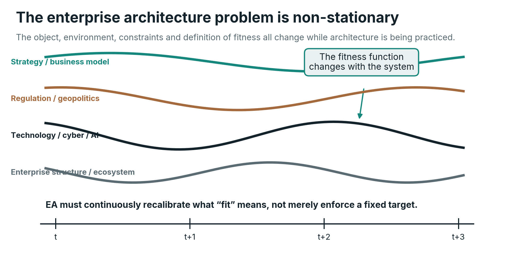
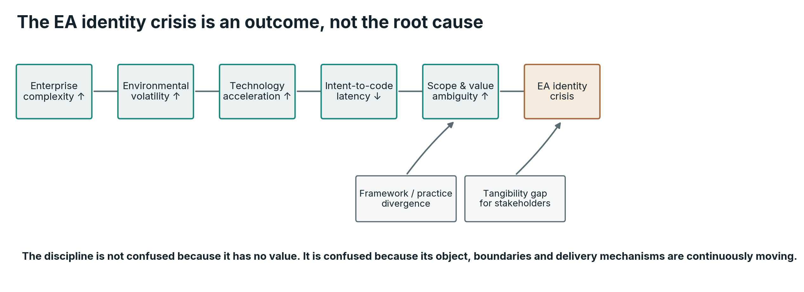
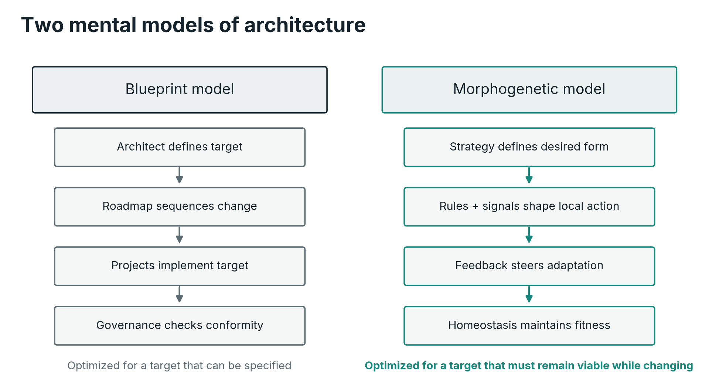
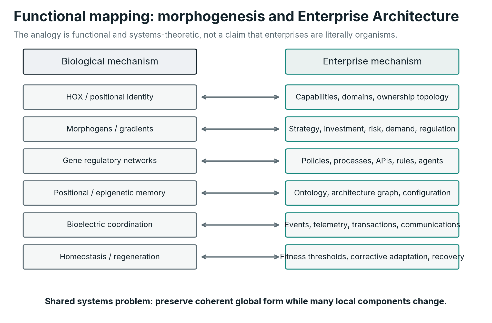
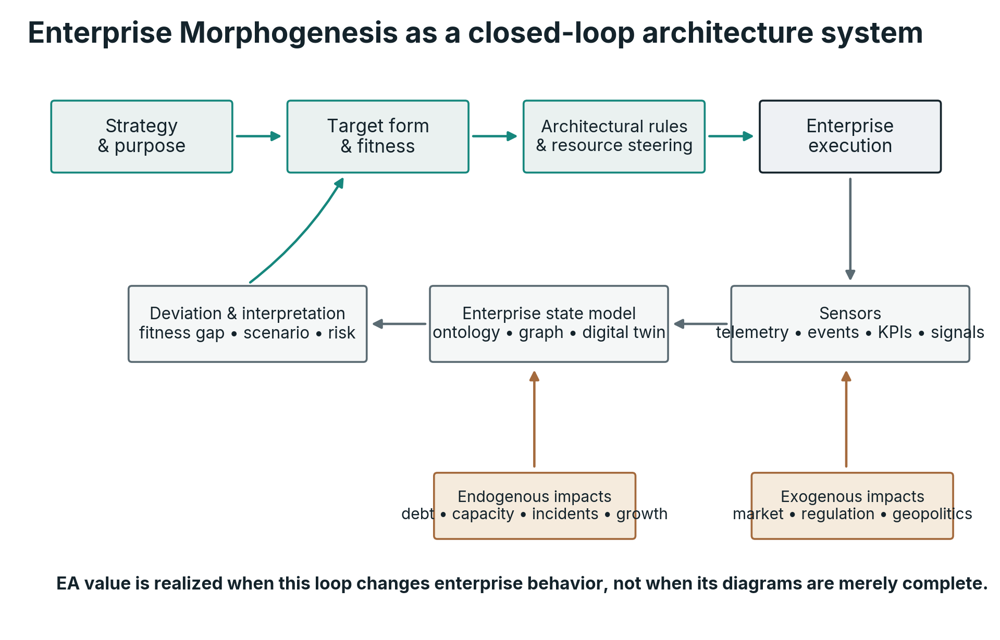
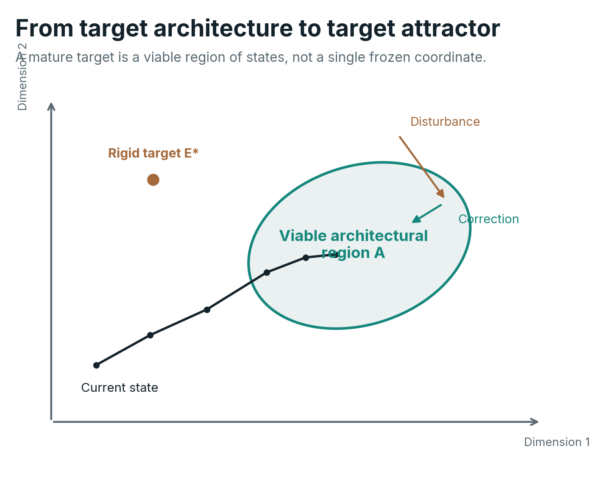
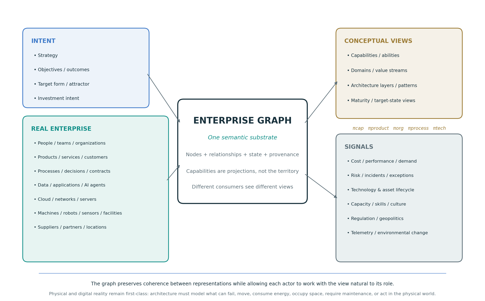
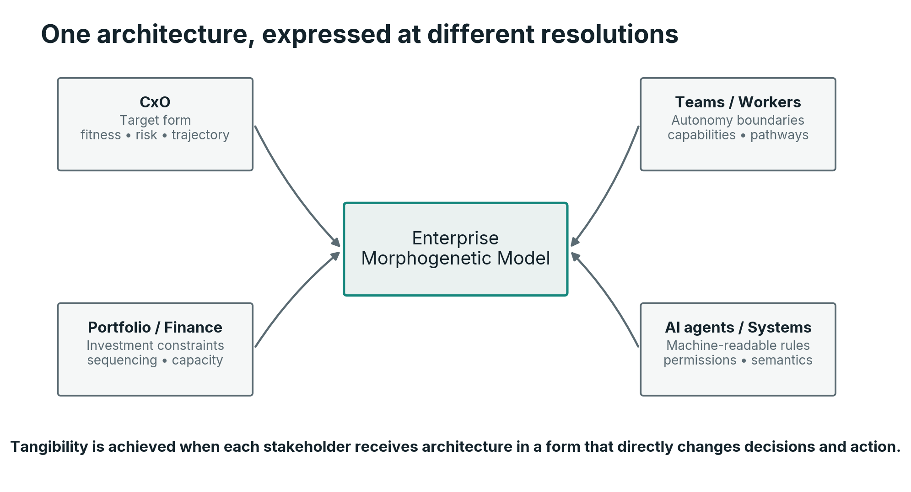
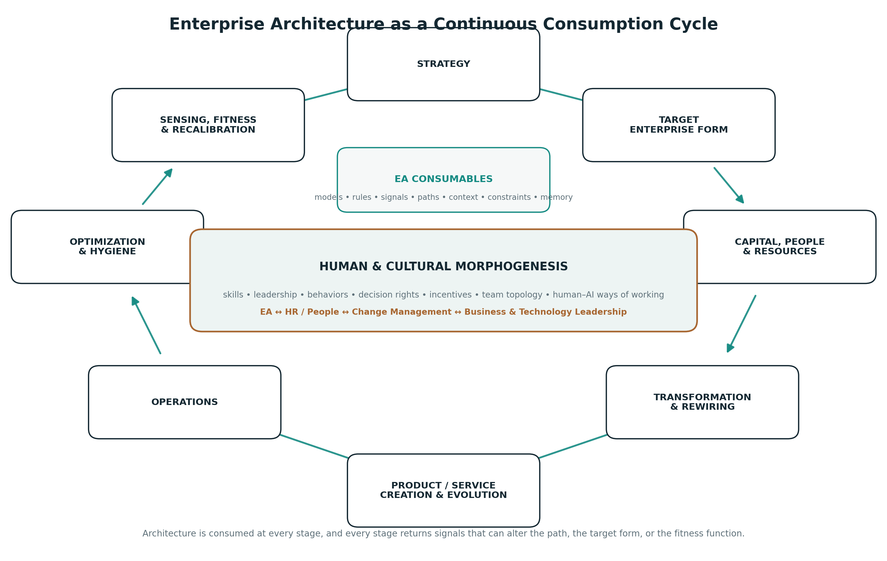
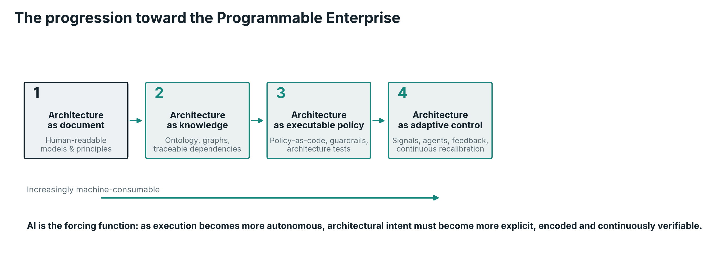

# Enterprise Morphogenesis

*Enterprise Architecture as the morphogenetic system of the enterprise: how strategy becomes a target form, and how that form is generated, scaled, and kept viable under continuous change.*

**[Yannick Huchard](https://yannickhuchard.com)** · Enterprise Architecture  
Version 1.0 · August 2026

---

# Abstract

Enterprise Architecture emerged to create coherence across increasingly complex organizations, information systems and technologies. Yet the object it seeks to architect has become non-stationary. Strategy, regulation, geopolitics, technology, organizational boundaries, customer expectations and software delivery mechanisms change continuously, while generative AI is compressing the distance between intent and executable systems. This white paper argues that the resulting tension cannot be resolved by better documentation alone. It requires a clearer theory of what Enterprise Architecture is for.

The central proposition is that Enterprise Architecture is the morphogenetic system of the enterprise. Its purpose is to translate strategic intent into a target enterprise form; establish the rules, resource constraints, signals and developmental mechanisms by which that form can emerge; align the human capabilities, skills, leadership and cultural conditions required to inhabit it; sense endogenous and exogenous change; preserve coherence during growth and disruption; steer multi-stage transformation; and maintain the enterprise within a viable range of states once maturity is reached. Developmental biology provides a functional analogy for these mechanisms through positional information, morphogens, gene regulatory networks, positional memory, homeostasis, regeneration and bioelectric signaling. Cybernetics provides the formal bridge through feedback, requisite variety and the principle that effective regulation requires an adequate model of the system being regulated. It also gives EA an architectural-integrity function: consequential decisions, exceptions and resource allocations should leave explicit, inspectable traces so that legitimate disagreement remains possible while opaque local capture becomes harder to hide.

The paper develops Enterprise Morphogenesis as a systems-theoretic extension of Enterprise Architecture rather than a replacement for existing frameworks. It proposes a shift from static target architecture to target attractors, from architecture documents to a living Enterprise Graph and machine-readable architectural memory, from project-by-project governance to executable constraints, and from the Enterprise Architect as cartographer or gatekeeper to the architect as navigator and designer of the mechanisms through which the enterprise continuously designs itself. Capabilities remain useful, but as transitive semantic constructs and projections of the graph rather than as the enterprise’s underlying anatomy. In an AI-native organization, this culminates in the Programmable Enterprise: an enterprise in which architecture is progressively encoded into ontologies, graph relationships, policies, interfaces, events, permissions, digital twins, observability and agent guardrails so that strategic coherence can survive increasing autonomy and speed across both digital and physical operations.

## Contents

- [Executive Summary](#executive-summary)
- [1. Enterprise Architecture in a Non-Stationary Enterprise](#1-enterprise-architecture-in-a-non-stationary-enterprise)
  - [1.1 Enterprise Architecture was born from complexity](#11-enterprise-architecture-was-born-from-complexity)
  - [1.2 The object being architected keeps moving](#12-the-object-being-architected-keeps-moving)
  - [1.3 A discipline whose boundary is coherence](#13-a-discipline-whose-boundary-is-coherence)
  - [1.4 The repeatability paradox](#the-repeatability-paradox)
  - [1.5 The framework-practice gap is predictable](#15-the-framework-practice-gap-is-predictable)
  - [1.6 The collapse of intent-to-execution latency](#16-the-collapse-of-intent-to-execution-latency)
  - [1.7 The identity crisis is a consequence](#the-identity-crisis-is-a-consequence)
- [2. From Blueprint to Morphogenesis](#2-from-blueprint-to-morphogenesis)
  - [2.1 We inherited the wrong dominant metaphor](#we-inherited-the-wrong-dominant-metaphor)
  - [2.2 What morphogenesis actually means](#22-what-morphogenesis-actually-means)
  - [2.3 Adjacent theories and what this framework adds](#23-adjacent-theories-and-what-this-framework-adds)
- [3. The Biological Mechanisms of Coherent Form](#3-the-biological-mechanisms-of-coherent-form)
  - [3.1 Positional information: identity depends on where a component belongs](#31-positional-information-identity-depends-on-where-a-component-belongs)
  - [3.2 Morphogens: global direction expressed as local signals](#32-morphogens-global-direction-expressed-as-local-signals)
  - [3.3 Gene regulatory networks: local rules generate global structure](#33-gene-regulatory-networks-local-rules-generate-global-structure)
  - [3.4 Positional memory: the system must remember what it is](#34-positional-memory-the-system-must-remember-what-it-is)
  - [3.5 Bioelectric signaling: a distributed state layer](#35-bioelectric-signaling-a-distributed-state-layer)
  - [3.6 Homeostasis, regeneration and the meaning of maintenance](#36-homeostasis-regeneration-and-the-meaning-of-maintenance)
  - [3.7 The biological analogy has boundaries](#37-the-biological-analogy-has-boundaries)
- [4. Cybernetics: From Analogy to Regulation](#cybernetics-from-analogy-to-regulation)
  - [4.1 Enterprise Architecture as a regulator](#41-enterprise-architecture-as-a-regulator)
  - [4.2 A regulator needs a model of the enterprise](#42-a-regulator-needs-a-model-of-the-enterprise)
  - [4.3 Control requires a closed loop](#control-requires-a-closed-loop)
  - [4.4 Architecture latency becomes a first-class metric](#44-architecture-latency-becomes-a-first-class-metric)
- [5. Enterprise Morphogenesis: A Theory of Enterprise Form](#5-enterprise-morphogenesis-a-theory-of-enterprise-form)
  - [5.1 Definition](#definition)
  - [5.2 Strategy becomes target form](#52-strategy-becomes-target-form)
  - [5.3 The target is an attractor, not a point](#53-the-target-is-an-attractor-not-a-point)
  - [5.4 The Enterprise Graph is the substrate; capabilities are projections](#54-the-enterprise-graph-is-the-substrate-capabilities-are-projections)
  - [5.5 Architectural invariants define identity](#55-architectural-invariants-define-identity)
  - [5.6 Developmental rules describe how form is reached](#56-developmental-rules-describe-how-form-is-reached)
  - [5.7 Architecture has a resource function](#architecture-has-a-resource-function)
  - [5.8 Sensing makes the enterprise aware of its own form](#58-sensing-makes-the-enterprise-aware-of-its-own-form)
  - [5.9 Adaptation changes the form without losing the enterprise](#59-adaptation-changes-the-form-without-losing-the-enterprise)
  - [5.10 Homeostasis maintains fitness after transformation](#510-homeostasis-maintains-fitness-after-transformation)
  - [5.11 Architectural integrity: resisting opaque local capture](#511-architectural-integrity-resisting-opaque-local-capture)
  - [5.12 Legible form: the enterprise must be navigable by its people](#512-legible-form-the-enterprise-must-be-navigable-by-its-people)
- [6. Growth, Navigation and the Preservation of Coherence](#6-growth-navigation-and-the-preservation-of-coherence)
  - [6.1 Growth is an architecture problem, not just a capacity problem](#61-growth-is-an-architecture-problem-not-just-a-capacity-problem)
  - [6.2 The Enterprise Architect as navigator](#62-the-enterprise-architect-as-navigator)
  - [6.3 Communication is part of the control mechanism](#63-communication-is-part-of-the-control-mechanism)
- [7. What Enterprise Architecture Is Supposed to Deliver](#7-what-enterprise-architecture-is-supposed-to-deliver)
  - [7.1 The target-form model](#71-the-target-form-model)
  - [7.2 Architectural invariants and developmental rules](#72-architectural-invariants-and-developmental-rules)
  - [7.3 The Enterprise Graph and semantic memory](#73-the-enterprise-graph-and-semantic-memory)
  - [7.4 The architectural fitness model](#the-architectural-fitness-model)
  - [7.5 The sensing and feedback architecture](#75-the-sensing-and-feedback-architecture)
  - [7.6 The transformation path](#76-the-transformation-path)
  - [7.7 Executable architecture](#executable-architecture)
  - [7.8 Enterprise Architecture as a continuous consumption cycle](#78-enterprise-architecture-as-a-continuous-consumption-cycle)
  - [7.9 People, culture and the rewiring of the enterprise](#79-people-culture-and-the-rewiring-of-the-enterprise)
  - [7.10 Decision provenance and architectural integrity](#710-decision-provenance-and-architectural-integrity)
- [8. AI Makes Morphogenetic EA Necessary](#8-ai-makes-morphogenetic-ea-necessary)
  - [8.1 AI does not remove architecture, it changes where architecture must live](#81-ai-does-not-remove-architecture-it-changes-where-architecture-must-live)
  - [8.2 From review-before-change to constraints-during-change](#82-from-review-before-change-to-constraints-during-change)
  - [8.3 Architecture context is a new infrastructure layer](#83-architecture-context-is-a-new-infrastructure-layer)
  - [8.4 Architectural autonomy must be earned](#84-architectural-autonomy-must-be-earned)
- [9. The Programmable Enterprise](#9-the-programmable-enterprise)
  - [9.1 Architectural condensation: how judgment becomes substrate](#91-architectural-condensation-how-judgment-becomes-substrate)
  - [9.2 Expression machinery: domain factories for condensed intent](#92-expression-machinery-domain-factories-for-condensed-intent)
  - [9.3 The technology base: capabilities, not products](#93-the-technology-base-capabilities-not-products)
- [10. A Pragmatic Example: A Regulated Insurer Under AI-Driven Growth](#10-a-pragmatic-example-a-regulated-insurer-under-ai-driven-growth)
  - [10.1 Does the framework generalize beyond digital services?](#101-does-the-framework-generalize-beyond-digital-services)
- [11. The Enterprise Architecture Operating Model That Follows](#11-the-enterprise-architecture-operating-model-that-follows)
  - [11.1 A new fitness function for the EA function itself](#111-a-new-fitness-function-for-the-ea-function-itself)
  - [11.2 Architectural integrity requires inspectability and independence](#112-architectural-integrity-requires-inspectability-and-independence)
  - [11.3 The fate of established architecture practices, and what is genuinely new](#113-the-fate-of-established-architecture-practices-and-what-is-genuinely-new)
  - [11.4 Establishing the practice: bootstrap, growth and the morphogenetic gauge](#114-establishing-the-practice-bootstrap-growth-and-the-morphogenetic-gauge)
- [12. Research Propositions and Validation Agenda](#12-research-propositions-and-validation-agenda)
- [13. Limits, Falsifiability and Responsible Use of the Analogy](#13-limits-falsifiability-and-responsible-use-of-the-analogy)
- [14. Conclusion: Architecture as the Enterprise’s Capacity to Become](#14-conclusion-architecture-as-the-enterprises-capacity-to-become)
- [Glossary](#glossary)
- [References](#references)

# Executive Summary

Enterprise Architecture was born from complexity and matured around description: frameworks, repositories, review boards and target-state blueprints. The object being architected, however, did not stabilize. Cloud moved the economics of infrastructure, SaaS moved ownership boundaries, data and cybersecurity changed the strategic terrain, platforms and regulation blurred and hardened borders in turn, and artificial intelligence now compresses the distance between intent and running change. Under these conditions the blueprint stance fails structurally, not managerially: when the feasible volume of change rises, every centrally reviewed decision joins a queue, and latency, not intent, becomes the governing variable of architecture.

The alternative is older than the discipline. Living systems produce and preserve coherent form without central review: no cell consults a master drawing, yet development converges reliably, repairs damage and adapts to circumstance. Biology calls the underlying capability morphogenesis. The core proposition of this paper follows: **Enterprise Architecture is the morphogenetic system of the enterprise**, the discipline that engineers the conditions under which a coherent enterprise form is generated, maintained, adapted and, when necessary, retired. This defines Enterprise Architecture as a practice of engineering at enterprise level.

The framework rests on a deliberately small formal core: the enterprise state, a time-indexed fitness function, a viable region that serves as the target attractor, and a deviation measure. Together they define a control loop rather than a plan. Strategy is translated into target form, and the biological analogy is decomposed into engineerable mechanisms: positional identity, architectural invariants, developmental rules, architectural memory, sensing, homeostasis and regeneration.

The substrate of these mechanisms is the Enterprise Graph: a time-aware semantic graph connecting organizational, informational, digital, physical, resource, governance and ecosystem state. It is consumed continuously by policy engines, agents and analyses, which makes staleness observable and consequential in ways static documentation repositories rarely achieved. Stakeholder views are projections of it. The form must also be learnable by its people: a curated Enterprise Atlas makes the enterprise navigable, and navigability is what turns a target form into shared direction, individual autonomy and leadership appropriation.

Humans and AI agents are both first-class inhabitants of this form. Agents receive positional identity and tiered autonomy bounded by executable constraints; convergent design is increasingly performed by human-led human-agent dyads; and judgment condenses progressively into the machine through an explicit loop of exception, ruling and encoding, so that scarce architectural attention keeps moving toward novelty.

For practice, no established Enterprise Architecture activity disappears; each stops producing descriptions and starts producing conditions, from reference architectures reframed as generative rule-sets to portfolio rationalization operated as standing homeostasis. Almost every individual element of the framework has precedent in cybernetics, complex adaptive systems research and evolutionary architecture. What is genuinely new is their integration into a single, executable control loop.

The argument is developed through a regulated-insurer worked example, tested against contrasting settings that mark the claimed scope, from pit-to-port mining to telecommunications form retirement, and closed with falsifiable propositions and a research program. The stance throughout is that **the mature Enterprise Architect does not design every part of the enterprise. The architect designs the mechanisms through which the enterprise continuously designs itself.**

# 1. Enterprise Architecture in a Non-Stationary Enterprise

## 1.1 Enterprise Architecture was born from complexity

The modern enterprise is an accumulation of decisions made at different times, under different constraints, by different actors, using technologies and physical assets with different lifecycles. It is a legal entity, but also a social system, a producer of products and services, a network of contracts, a financial allocation system, an information-processing system and an increasingly software-mediated socio-technical and physical system. The same customer outcome may cross organizational units, applications, APIs, outsourced providers, data platforms, identity services, servers, networks, devices, facilities, machines or robots, regulatory controls and human decisions before value is produced. No single engineering discipline owns that whole.

Enterprise Architecture emerged because this whole matters. The usefulness of Zachman’s early framework was not that it supplied another diagramming notation. It recognized that the increasing size and complexity of information systems required a logical construct capable of organizing multiple descriptions and perspectives ([Zachman, 1987](#ref-zachman1987)). TOGAF later institutionalized a method for developing and governing architecture across business, data, application and technology concerns ([The Open Group, 2022](#ref-togaf2022)). These frameworks differ in nature, but both respond to the same underlying need: when local design is insufficient to preserve global coherence, an enterprise-level discipline becomes necessary.

That need has only intensified. Research links increasing information-systems architecture complexity with lower efficiency, flexibility, transparency and predictability, and finds that enterprise architecture management can mitigate some of these effects ([Beese et al., 2023](#ref-beese2023)). This is the practical reason EA exists. It is not because executives need a better inventory of boxes. It exists because complexity creates externalities. A local technology choice can create group-wide cyber exposure. A local data model can multiply reconciliation costs. A duplicated capability can fragment customer experience. A sourcing decision can create geopolitical or operational concentration risk. An apparently cheap application can impose integration and lifecycle costs on dozens of neighboring systems. Architecture is the discipline that makes these relationships visible before local optimization becomes systemic debt.

Yet complexity alone does not explain the contemporary tension around EA. Complexity could, in principle, be mastered by a stable body of methods if the underlying object changed slowly. The enterprise does not.



*The enterprise architecture problem is non-stationary. Strategy, regulation, technology and the enterprise itself move simultaneously, requiring the definition of architectural fitness to be recalibrated over time.*

## 1.2 The object being architected keeps moving

A useful architecture is always relative to a context. A centralized infrastructure design that was economically rational before elastic cloud services may become a constraint later. A data architecture designed before machine learning becomes strategic may undervalue lineage, quality, semantics and real-time accessibility. A security model built around a corporate network perimeter can become incoherent when users, APIs, devices and workloads are distributed across clouds and partners. A software portfolio optimized for human-operated workflows may become structurally wrong when AI agents can execute parts of the workflow directly.

The architecture problem is therefore **non-stationary**. In statistical language, the process generating the relevant conditions does not preserve one stable distribution. Strategy changes. Regulation changes. Market structure changes. Technology changes. Threats change. The available workforce and its productivity change. Suppliers merge, fail or move. New technologies alter the feasible design space. A target architecture that was optimal under yesterday’s assumptions can become actively harmful under tomorrow’s.

Let the enterprise at time $t$ be represented by a state vector

$$
{E}_{t}=\left( {O}_{t},{I}_{t},{D}_{t},{H}_{t},{P}_{t},{R}_{t},{G}_{t},{K}_{t}\right)
$$

where O represents the organizational and human state - including structure, roles, workforce abilities, skills, team topology and relevant cultural or behavioral conditions - I information and data, D digital systems and technology such as software, applications, cloud services, models, agents and logical networks, H the physical asset and environment state such as servers and hardware, devices, machinery, robots, sensors and actuators, vehicles, facilities, power and cooling infrastructure, P processes and value flows, R resources and capital allocation, G governance and constraints, and K ecosystem relationships such as customers, partners and suppliers. Capabilities are deliberately not treated as a primitive component of this state vector: they are useful abstractions of what combinations of these elements enable the enterprise to do. Let S_t represent strategic intent and X_t represent the external environment. A simple architectural fitness function can then be written as

$$
{\Phi }_{t}=\Phi \left( {E}_{t},{S}_{t},{X}_{t}\right).
$$

The subscript matters. In a non-stationary enterprise, we should expect

$$
{\Phi }_{t+1}\neq {\Phi }_{t}
$$

whenever strategy, regulation, technology, risk appetite or environmental conditions materially change. This does not mean every architectural principle changes every week. Some invariants should be deliberately durable. It means the definition of a fit enterprise cannot be assumed to be permanent.

This reframes architecture work. Enterprise Architecture is not only responsible for helping the enterprise move toward a desired state. It must continuously reassess whether the desired state remains desirable. Recalibration is therefore not a sign that architecture failed to predict the future. It is part of the function.

A note on formalism. The mathematical expressions used in this paper are deliberately few, and they are not decorative. The citable formal core consists of four objects that build on one another: the enterprise state ${E}_{t}$, the fitness function ${\Phi }_{t}$, the viable region ${\mathcal{A}}_{t}$ introduced in Section 5.3, and the deviation measure ${d}_{t}$ introduced in Section 5.10. Together they define the control loop of Enterprise Morphogenesis and are intended as a compact, reusable formal platform for enterprise contexts, consistent with the view of Enterprise Architecture as an engineering practice at enterprise level. Other formal expressions in the paper, such as the queueing illustration in Section 1.6, are illustrative arguments rather than parts of that core.

## 1.3 A discipline whose boundary is coherence

This helps explain why the boundaries of EA have never been as crisp as those of many engineering specialties. A database engineer can point to a database. A network engineer can identify a network. A UX designer can identify an interaction surface. A mechanical or industrial engineer can point to a machine. An Enterprise Architect is expected to reason across products and services, organizational responsibilities, information, digital systems, physical assets, security, investment, sourcing, delivery, regulation and increasingly AI. Empirical work on the Enterprise Architect profession confirms wide variation in role expectations (Besker et al., 2015).

It is tempting to interpret this as evidence that the discipline lacks maturity. Some of it certainly reflects historical inconsistency. But part of the ambiguity is structural. **Most engineering disciplines own a domain. Enterprise Architecture owns coherence across domains.** Coherence is relational. It appears in the interfaces between business and technology, strategy and investment, local autonomy and enterprise reuse, data ownership and data consumption, speed and control, product independence and shared platforms. The border moves because the relationships that threaten coherence move.

This gives EA a peculiar position. It cannot legitimately own every function it influences. Portfolio management owns investment processes; security owns security operations and policy; engineering owns delivery; business leaders own business outcomes; data leaders own data management. Yet architecture must understand enough of each to make cross-domain consequences visible and to shape the constraints under which those functions interact. The role is therefore integrative by design.

## 1.4 The repeatability paradox

A discipline operating across unstable boundaries still needs repeatability. Without it, architecture becomes dependent on the personality and intuition of individual architects. Frameworks solve a real problem by supplying classifications, processes, viewpoints, governance patterns and common language. The paradox is that the more faithfully organizations try to standardize an architecture method, the more they risk freezing practices around conditions that are specific to another organization or another era.

The question is not whether EA should be repeatable. It must be. The better question is **what should be repeated**.

Biology offers an early clue. Organisms do not repeatedly reproduce one adult body molecule by molecule. Development repeatedly applies mechanisms that can generate viable form despite variation in cells, environment and growth. The enterprise analogue is to seek repeatable architectural mechanisms rather than identical architectural outputs. The reusable unit is not the diagram. It is the method by which strategic intent becomes structural constraints, by which local decisions receive positional context, by which deviations become visible, and by which the enterprise is steered back toward a viable region.

This distinction reconciles framework and adaptation. TOGAF, Zachman and architecture description standards such as ISO/IEC/IEEE 42010:2022 can remain valuable instruments. Enterprise Morphogenesis does not ask practitioners to discard them. It asks a different question: **what regulating system must exist around those instruments so that architecture remains useful while the enterprise changes?**

## 1.5 The framework-practice gap is predictable

Empirical EA research has repeatedly found that benefits depend on how architecture is used, not merely on whether architecture artifacts exist. Foorthuis and colleagues show an indirect benefit path through architectural insight and conformance ([Foorthuis et al., 2016](#ref-foorthuis2016)). Niemi and Pekkola show that benefit realization depends on intertwined organizational activities and contextual factors ([Niemi & Pekkola, 2020](#ref-niemi2020)). Dynamic EA capability research similarly links EA value to the organization’s ability to use architecture capabilities in support of process innovation and business-IT alignment ([Wetering, 2021](#ref-wetering2021)).

This is exactly what we should expect if EA is a regulating function. A map has no value because it is accurate in isolation. It has value because somebody uses it to navigate. A policy has no value because it exists. It has value because it changes decisions. A capability model has no value because every box has been classified. It has value when it changes investment, ownership, reuse or transformation sequencing. Architecture artifacts are therefore closer to encoded signals and memory than to final products.

The practical gap between framework promise and enterprise reality is not surprising. A framework can define a method, but it cannot predefine the enterprise’s actual fitness function, political structure, resource constraints, culture, technology debt, regulation or rate of change. Those variables determine how the architecture function must operate. There can be a repeatable meta-method, but there cannot be one universally optimal EA operating model.

## 1.6 The collapse of intent-to-execution latency

Generative AI intensifies the problem because it changes the economics of implementation. In one controlled experiment, developers using GitHub Copilot completed a specific JavaScript HTTP-server task 55.8 percent faster than the control group, although the authors explicitly caution against generalizing that result to all software work ([Peng et al., 2023](#ref-peng2023)). More recent field experiments across Microsoft, Accenture and another large company provide evidence that generative AI can increase software-development output in real organizational settings, with effects that vary by context and experience ([Cui et al., 2026](#ref-cui2026)). Meanwhile, SWE-bench and SWE-agent illustrate the progression from code completion toward agents that can read issue descriptions, navigate repositories, edit files and execute tests ([Jimenez et al., 2024](#ref-jimenez2024); [Yang et al., 2024](#ref-yang2024)).

The strategic fact is not one benchmark percentage. It is the shrinking distance between **intent** and **executable change**. A business expert can increasingly describe an application, workflow, data transformation or agent behavior in natural language and obtain a working artifact without traversing every traditional handoff. The chain

$$
\mathrm{Intent}\rightarrow \mathrm{Requirements}\rightarrow \mathrm{Design}\rightarrow \mathrm{Code}\rightarrow \mathrm{Deployment}
$$

is not disappearing, but some of its steps are being compressed, automated or performed recursively by AI systems. As the latency of that chain falls, the volume of proposed changes can rise dramatically.

This creates a scalability problem for architecture governance. Assume architectural decisions arrive at average rate $\lambda$ and a centralized review function can process them at rate $\mu$. In a deliberately simplified M/M/1 queue, utilization is

$$
ρ=\frac{\lambda }{\mu },
$$

and expected queueing time is

$$
{W}_{q}=\frac{\lambda }{\mu \left( \mu -\lambda\right)}.
$$

The model is not meant to claim that architecture boards literally follow Poisson arrivals or exponential service times. Its value is to expose the structural effect. As $\lambda$ approaches $\mu$, waiting time rises sharply. Generative AI increases the feasible arrival rate of changes while human review capacity remains comparatively fixed. The organization then has three bad options: wait, bypass architecture, or expand governance headcount in proportion to change volume.

There is a fourth option: **move architecture into the environment in which change happens**. If rules, semantic constraints, security policies, reuse expectations, API contracts, lifecycle rules and architectural tests can be evaluated automatically, the architecture function no longer needs to manually inspect every decision. Human architects can focus on ambiguous, novel and high-consequence choices. This is one of the strongest reasons the AI age increases the need for architecture rather than diminishing it.

## 1.7 The identity crisis is a consequence

The visible symptoms now become easier to explain. Engineers ship software. Designers ship interfaces. Product teams ship products and features. Data teams ship data products and models. In delivery cultures, visible production provides an intuitive proof of value. The Enterprise Architect may instead produce a principle, a capability model, an exception decision, a target architecture or a recommendation whose benefit is realized elsewhere and later.

As implementation becomes faster, this asymmetry becomes harder to defend using the old language of architecture. A six-week governance cycle around a system that an AI-assisted team can prototype in a day will be perceived as friction, even when the architectural concern is legitimate. Architects may respond by becoming more technical and solution-oriented, by retreating into governance, or by broadening into strategy. CxOs may interpret the inconsistency as evidence that the role itself is unclear. Practitioners experience the same ambiguity internally: are they designers, advisors, reviewers, strategists, standards owners, technologists, portfolio shapers or transformation leaders?



*The EA identity crisis is modeled here as a consequence of interacting structural pressures rather than the primary problem.*

The identity problem is therefore real, but beginning with it produces the wrong diagnosis. The more fundamental issue is that Enterprise Architecture has lacked a sufficiently explicit theory of its **generative and regulating function**. Once that function is clear, the artifacts, roles and boundaries can be derived from it rather than negotiated from scratch in every organization.

# 2. From Blueprint to Morphogenesis

## 2.1 We inherited the wrong dominant metaphor

Architecture language naturally borrowed from construction. We speak of blueprints, foundations, layers, building blocks, target states and roadmaps. These metaphors are useful because they make complexity tangible. They also carry assumptions that become dangerous when used unconsciously. A building has an external designer. Its components do not make local strategic choices. Construction proceeds toward a state in which the object is substantially complete. Once occupied, the building may be maintained or renovated, but its structure is not expected to continuously reconfigure itself in response to customers, competitors, regulation or new forms of computation.

An enterprise is fundamentally different. There is no moment at which a large enterprise becomes complete. It operates while it transforms. Its components have agency. People interpret strategy, negotiate priorities and sometimes resist it. Applications execute rules written years earlier. Suppliers introduce dependencies outside the organization’s direct control. Customers change behavior. Regulators change constraints. Acquisitions add new structures without pausing the existing operation. Employees leave and are replaced, applications are retired, data migrates, processes are redesigned, and still the enterprise is expected to remain recognizably itself.

This is closer to a living system than to a building. The comparison does not require biological romanticism. It follows from properties of the system: continuous operation, component turnover, distributed action, environmental exchange, growth, differentiation, repair and adaptation. The relevant architectural question becomes less “what blueprint should we build?” and more “what mechanisms make a coherent form emerge and remain viable despite continuous change?”



*Two mental models of architecture. The blueprint model focuses on an externally designed target object. The morphogenetic model focuses on distributed rules, signals, memory and feedback that repeatedly generate and preserve viable form.*

The distinction matters because the two models produce different governance. Blueprint thinking naturally centralizes design authority. Morphogenetic thinking concentrates on **local autonomy bounded by global rules**. Blueprint thinking favors a precise target state. Morphogenetic thinking favors a target region and mechanisms of convergence. Blueprint thinking treats deviation primarily as non-compliance. Morphogenetic thinking distinguishes destructive deviation from adaptive variation. Blueprint thinking assumes architecture is mostly defined before implementation. Morphogenetic thinking assumes architecture is continuously expressed through implementation and feedback.

## 2.2 What morphogenesis actually means

In developmental biology, morphogenesis refers to the processes that generate form. A fertilized egg does not contain a microscopic anatomical drawing of the adult organism. The genome provides molecular components, regulatory logic and developmental possibilities, but form emerges through interactions among gene expression, signaling, cell behavior, mechanical forces and environmental context. Cells proliferate, migrate, differentiate, adhere, die, change shape and communicate. The macroscopic body arises from coordinated local processes.

This distinction between **description of anatomy** and **generation of anatomy** is the conceptual pivot of this paper. A capability map, application landscape or information model describes aspects of an enterprise’s anatomy. Enterprise Morphogenesis asks what mechanisms cause the desired enterprise anatomy to emerge, scale, repair and persist.

The analogy becomes useful when decomposed into mechanisms rather than slogans. Developmental biology supplies several mechanisms that have recognizable functional counterparts in enterprise systems: positional identity, signaling gradients, regulatory networks, memory, feedback and regeneration. None should be copied literally. Each helps isolate a design problem that Enterprise Architecture must solve.

## 2.3 Adjacent theories and what this framework adds

Enterprise Morphogenesis does not emerge in a vacuum. Several established bodies of work approach the same underlying question, and the relationship should be stated explicitly so that the contribution of this framework is judged against them rather than mistaken for a renaming of them.

The closest intellectual neighbor is Stafford Beer’s Viable System Model, which applied the cybernetics of Ashby directly to organizations (Beer, 1972, 1985). The VSM decomposes any viable organization into five interacting systems covering operations, coordination, internal regulation and audit, environmental intelligence, and identity and policy, applied recursively at every level of the organization. Several mechanisms proposed in this paper have recognizable VSM counterparts: architectural sensing corresponds to Beer’s intelligence function, invariants to identity and policy closure, homeostasis to internal regulation, and developmental rules to the coordination that prevents local units from oscillating against one another. What the VSM does not provide is a developmental theory. It regulates the viability of a current form, but says little about how strategic intent is translated into a *target* form and how a multi-stage transformation is steered toward it, and it predates machine-readable substrates. Enterprise Morphogenesis can therefore be read as adding a developmental axis and an executable substrate, in the form of the Enterprise Graph, encoded invariants and agent-accessible context, to the regulatory structure that Beer identified.

Complex adaptive systems research explains how decentralized agents produce emergent order. Holland’s mechanisms of tagging, internal models and building blocks (Holland, 1995) prefigure positional identity and the model-dependence of regulation developed in Sections 3 and 4. Snowden and Boone’s Cynefin framework distinguishes decision contexts and, for complex domains, recommends probing and sensing over predictive planning, while separating constraints that prohibit from constraints that enable action (Snowden & Boone, 2007). That separation maps directly onto the distinction between architectural invariants and developmental rules with their associated platform resources. The difference lies in ambition. Complex adaptive systems theory is descriptive science and Cynefin is a sense-making heuristic for leaders. Enterprise Morphogenesis is prescriptive: it deliberately designs the tags, signals, constraints and feedback so that emergence converges toward a strategically chosen viable region defined by an explicit fitness function.

The closest practitioner vocabulary comes from evolutionary architecture, in which architectural fitness functions are automated tests of architectural characteristics executed continuously in delivery pipelines to enable guided, incremental change (Ford et al., 2022). Sections 5.5 and 7.7 deliberately generalize that idea. Evolutionary architecture fitness functions operate at the level of a software system and evaluate code and deployments. The fitness function ${\Phi }_{t}$ introduced in this paper operates at enterprise level and covers organizational, informational, digital, physical, resource, governance and ecosystem state, including phenomena that no delivery pipeline can test, such as resource-flow divergence, workforce readiness or opaque local capture. Enterprise Morphogenesis generalizes the architectural fitness function from the software system to the enterprise as a whole, and supplies the substrate, the Enterprise Graph, that makes enterprise-level fitness evaluable.

Finally, the living-enterprise metaphor itself has precedent. De Geus described long-lived companies as living systems that learn, adapt and preserve identity (de Geus, 1997). That work is observational and philosophical; it names the phenomenon without supplying mechanisms. The claim of this paper is more demanding: the biological comparison is only useful when it is decomposed into engineerable mechanisms, positional identity, signals, regulatory rules, memory, sensing and feedback, each of which can be built, tested and operated. That decomposition expresses the underlying ambition of Enterprise Morphogenesis: to define Enterprise Architecture as a practice of **engineering at enterprise level**, a discipline that designs, tests and operates the mechanisms through which a coherent enterprise form is generated and maintained, rather than one that only describes form after the fact.

# 3. The Biological Mechanisms of Coherent Form

## 3.1 Positional information: identity depends on where a component belongs

Lewis Wolpert’s concept of positional information addressed a deceptively simple question: how can genetically similar cells differentiate into distinct structures according to their location within a developing organism? ([Wolpert, 1969](#ref-wolpert1969)) Cells need more than a list of possible behaviors. They need context. A cell that can become several tissue types must interpret signals in relation to where it is and to its developmental history.

HOX genes provide one important example of regional identity. Work on homeotic genes demonstrated that regulatory genes can determine segmental identity, with changes capable of transforming the developmental fate of body regions ([Lewis, 1978](#ref-lewis1978)). In vertebrates, related HOX clusters participate in anterior-posterior patterning. It would be incorrect to call HOX genes a complete body blueprint. Their significance for our argument is narrower and more useful: **the same local component behaves differently because the system carries positional identity**.

Enterprises face the same logical requirement. A customer-data service, underwriting rule, claims model or identity capability should not be interpreted merely as an isolated component. Its meaning depends on where it belongs in the enterprise topology: which business capability it serves, which domain owns its semantics, which jurisdictions it operates in, which platform boundaries apply, which data it is authoritative for, and which neighboring capabilities it may legitimately depend on.

Without positional identity, enterprises accumulate structural ambiguity. Two teams may both build “customer profile” services because each sees only its local need. A machine-learning team may create a risk score without knowing which capability is accountable for the decision it influences. An AI agent may be technically able to retrieve a document but have no semantic understanding of whether that document belongs to a regulated decision process. Capability architecture, domain models and ownership structures therefore perform a function more fundamental than cataloguing. They establish the **coordinates within which local behavior has meaning**.

Capabilities remain useful in this positional problem, but they should not be mistaken for the enterprise’s physical or organizational anatomy. An ability such as 'assess a claim,' 'manage customer identity,' 'price risk' or 'settle payment' can persist while teams move, applications change, processes are redesigned and physical or digital resources are replaced. Capability is therefore one useful semantic coordinate for describing persistent ability across changing realization. Enterprise Morphogenesis later places that coordinate inside a broader Enterprise Graph so that products, teams, processes, systems, physical assets and other stakeholder views remain equally legitimate projections of the same enterprise.

## 3.2 Morphogens: global direction expressed as local signals

Positional identity alone does not generate form. Developing tissues also exchange signals. Morphogens are signaling molecules whose distribution can convey positional information and influence cell fate. The classical concept is that cells exposed to different concentrations or durations of a signal can activate different developmental programs. Sonic Hedgehog provides a well-known example: experiments showed that different concentrations can induce distinct neural cell identities ([Roelink et al., 1995](#ref-roelink1995)). WNT signaling plays major roles in polarity and tissue identity; in planarian regeneration, wound-induced Wnt signaling is central to the head-versus-tail polarity decision ([Petersen & Reddien, 2009](#ref-petersen2009)).

The enterprise equivalent is not a molecule. It is the set of **directional signals that change local decision probabilities without prescribing every local action**. Strategy is one such signal. Investment thresholds are another. Risk appetite, regulatory requirements, technology standards, customer demand, pricing, internal transfer costs, performance indicators and executive priorities all alter what teams choose to build and how they behave.

Consider a strategic objective to make an insurance group “AI-first in operations.” That phrase is not executable. If it is real, it should alter multiple local systems differently. Claims teams may automate document interpretation and triage. KYC teams may use AI for investigation and outreach. Engineering may establish agent runtimes, model gateways and observability. HR may redesign skill development. Risk and compliance may establish evaluation and accountability controls. Finance may alter the investment envelope. The same strategic signal produces different responses because each domain has different positional identity.

The architectural task is therefore not simply to publish strategy. It is to **translate strategy into a system of signals that can be interpreted locally**. Strategy that never changes resource allocation, standards, target metrics, permissions or platform capabilities is analogous to a morphogen that never reaches a receptor. It may exist in presentation slides, but it does not shape form.

This also clarifies why architectural communication must occur at different resolutions. A CxO needs to understand the intended form and strategic trade-offs. A portfolio manager needs investment signals and sequencing. A product team needs decision boundaries and reusable capabilities. An application or AI agent needs machine-readable policies, APIs and permissions. The signal is shared, but the representation differs according to the receiving component.

## 3.3 Gene regulatory networks: local rules generate global structure

Developmental biology does not rely on one master switch for each organ. Regulatory genes interact in networks. Davidson and colleagues showed how gene regulatory networks can be represented as systems of interactions that control developmental processes ([Davidson et al., 2002](#ref-davidson2002)). Levine and Davidson later described such networks as logic maps that drive development by regulating transcription factors and downstream genes ([Levine & Davidson, 2005](#ref-levinedavidson2005)). The significance is architectural: complex form can arise from distributed conditional logic rather than from centralized micromanagement.

An enterprise already contains analogous regulatory networks. Processes specify conditional flows. Policies allow and prohibit actions. APIs constrain valid interactions. Security models encode permissions. Financial controls set thresholds. Data contracts define acceptable structures. Product rules determine eligibility. AI models influence decisions. Human escalation paths resolve ambiguity. Increasingly, autonomous agents will participate in these networks, calling tools and other agents according to goals and context.

A simplified enterprise regulatory rule might read:

$$
\mathrm{AutoSettle}=1\mathrm{if}\left\{ \begin{matrix}\mathrm{coverage\ valid}=1, \\ \mathrm{fraud\ risk}<{τ}_{f}, \\ \mathrm{claim\ value}<{τ}_{v}, \\ \mathrm{model\ confidence}>{τ}_{c}, \\ \mathrm{mandatory\ evidence\ present}=1.\end{matrix}\right\}
$$

No architect needs to approve each claim. Architecture determines which capability owns the rule, what data is authoritative, which thresholds can be changed by whom, which controls must always apply, how decisions are observable and when human intervention is mandatory. The regulatory network then executes repeatedly at scale.

This is the transition from **architecture as instruction to architecture as encoded behavior**. The more the enterprise can express architectural intent through reusable rules and interfaces, the less it depends on continuous centralized interpretation.

## 3.4 Positional memory: the system must remember what it is

Development does not end when an initial pattern appears. Tissues must maintain identity. Research on human fibroblasts found persistent, topographically differentiated gene-expression patterns associated with their anatomical origin ([Chang et al., 2002](#ref-chang2002)). This is one example of positional memory: differentiated cells can retain information related to where they belong even outside their original tissue environment.

Enterprises also need memory, but much of it is fragmented across people, documents, repositories, source code, configuration, tickets, contracts, CMDBs and databases. When a senior architect leaves, a surprising amount of “why the enterprise is shaped this way” can leave with them. When an AI agent encounters the organization through document search alone, it may retrieve facts without understanding which fact is authoritative, current or applicable to the decision at hand.

Morphogenetic EA therefore requires **architectural memory as an operational asset**. This memory includes the capability and domain model, semantic ontology, decision records, architectural invariants, technology lifecycle state, ownership, dependencies, data lineage, policies, exceptions and transformation history. It must distinguish current state from target state and intended future options. It must also be addressable by machines.

A static repository is insufficient if the state changes faster than the repository. Architectural memory must increasingly be connected to operational truth: cloud inventories, deployment manifests, source repositories, identity systems, event catalogs, data platforms, financial systems and observability. The architecture graph should not attempt to duplicate every source of truth. It should provide a semantic layer that relates them.

In that sense, an enterprise ontology is not an academic luxury. It is a mechanism for ensuring that humans and machines refer to the same organizational concepts when they reason and act. As AI agents become capable of making more local decisions, semantic positional memory becomes one of the principal means of preventing autonomy from degenerating into fragmentation.

## 3.5 Bioelectric signaling: a distributed state layer

Every living cell maintains electrical properties across its membrane. Neurons are the familiar example, but bioelectric signaling is not restricted to nervous systems. Developmental and regenerative biology has demonstrated causal relationships between non-neural membrane voltage and morphogenesis. Pai and colleagues showed that transmembrane voltage patterns participate in eye development in *Xenopus laevis*, and that manipulating ion transport can alter eye patterning ([Pai et al., 2012](#ref-pai2012)). Durant and colleagues showed in planarians that transient alteration of endogenous bioelectric signaling could produce persistent changes in the anatomical pattern regenerated after injury ([Durant et al., 2017](#ref-durant2017)). Levin’s broader research program treats such bioelectric circuits as a reprogrammable layer involved in embryogenesis, regeneration and disease ([Levin, 2021](#ref-levin2021)).

These findings deserve precision. They do not establish that tissues possess a conscious image of the final body. They do establish that developmental information is not exhausted by DNA sequence, and that dynamic physiological states can participate causally in the control of anatomical outcomes.

For Enterprise Architecture, this suggests a useful category distinct from static structure: **enterprise state fields**. Transactions, events, telemetry, customer complaints, workforce load, cost flows, risk indicators, service latency, cyber alerts, model drift and financial metrics collectively express the current physiological state of the enterprise. A capability may look correct in a repository while operational signals reveal that it is unhealthy.

Imagine a claims capability whose structural diagram has not changed. Over several weeks, claims processing time rises, customer complaints increase, manual overrides multiply, model confidence falls and the unit cost per claim increases. No single signal proves architectural failure. Together they indicate movement away from a viable state. If the enterprise can relate those signals to the capability, processes, systems and policies that generate them, it acquires the ability to diagnose and correct architecture based on lived state rather than periodic documentation.

This is one of the most powerful lessons from the biological comparison. **Architecture needs both structure and state.** Anatomy tells us what is connected. Physiology tells us how the system is currently behaving.

## 3.6 Homeostasis, regeneration and the meaning of maintenance

A living system must remain within viable bounds despite disturbance. Temperature, energy, pH, water balance and many other variables are regulated rather than held at one exact value. This is homeostasis: stability through active adjustment, not immobility.

Traditional EA governance often treats maintenance as conformance to a prescribed design. A morphogenetic view treats maintenance as **continuous correction toward viability**. The distinction is important. An architecture that never changes is not necessarily stable. It may simply be accumulating misfit as its environment changes.

Regeneration adds a second idea. When biological structures are damaged, repair is not merely replacement of material. The system must restore organized function. Planarian regeneration is striking because fragments can rebuild missing structures with correct polarity under normal conditions, and pattern-regulating pathways such as WNT participate in that process ([Petersen & Reddien, 2009](#ref-petersen2009)). Levin’s bioelectric experiments further show that the regenerative target can be experimentally perturbed ([Durant et al., 2017](#ref-durant2017)).

Enterprises also experience injury: cyber incidents, system failures, supplier collapse, regulatory breaches, acquisitions, abrupt market shifts and loss of key capabilities. Business continuity typically asks whether operations can resume. Enterprise Morphogenesis asks a wider question: **can the enterprise restore coherent form rather than merely restart components?** Recovery architecture should therefore include not only technical redundancy but semantic ownership, decision rights, alternative sourcing, data reconstruction, manual fallback, financial limits and the capability relationships required to recover end-to-end outcomes.

## 3.7 The biological analogy has boundaries

The strength of a new framework depends partly on knowing where it stops. An enterprise contains conscious people with explicit goals, political interests, contracts, cultures and legal responsibilities. Cells do not negotiate annual budgets or deliberately reinterpret strategy. Biological evolution has no executive committee. Organizations can redesign themselves intentionally and can externalize functions through markets. Enterprises can also fail for reasons that have no useful biological counterpart.

For that reason, this paper does not claim an ontological equivalence between enterprises and organisms. It claims a **functional correspondence at the level of distributed regulation and form**. The mapping is useful when it helps identify a missing mechanism, predict a failure mode or design a better control. It should be rejected wherever it becomes decorative or obscures distinctly organizational phenomena.



*Functional correspondence between selected mechanisms in developmental biology and proposed Enterprise Morphogenesis mechanisms. The mapping is systems-theoretic, not literal.*

The test of the analogy is therefore pragmatic. Does positional identity help us design clearer capability ownership? Do signaling concepts help us translate strategy into local incentives and constraints? Does regulatory-network thinking help us encode architecture closer to execution? Does positional memory help AI and humans reason consistently about the enterprise? Does a physiological state model detect architectural drift earlier? If the answer is yes, the analogy has earned its place. If not, it should be discarded.

# 4. Cybernetics: From Analogy to Regulation

Biology gives us mechanisms that make distributed form easier to visualize. Cybernetics gives us a language for explaining why those mechanisms matter to any adaptive system, including an enterprise.

## 4.1 Enterprise Architecture as a regulator

Cybernetics concerns communication and control in systems. Ashby’s work established a principle that remains highly relevant to modern enterprises: a regulator can only control disturbances to the extent that its repertoire of responses is sufficient for the variety it faces ([Ashby, 1956](#ref-ashby1956)). Beer later applied this cybernetic apparatus directly to organizations through the Viable System Model (Beer, 1972, 1985), a lineage positioned in Section 2.3. In simplified form, if $D$ is the variety of disturbances, $U$ the variety available to the regulator, and $O$ the variety permitted in essential outcomes, the regulator must be capable of absorbing enough disturbance variety that the resulting outcome remains within acceptable limits. A common conceptual expression is

$$
V\left( U\right)\geq V\left( D\right)-V\left( O\right).
$$

This is not a plug-in formula for counting architecture decisions. It expresses a structural truth. A rigid organization with only one permitted response is fragile in an environment with many materially different disturbances. Conversely, an organization with unlimited local response but no shared constraints may be adaptable locally while losing enterprise coherence. Effective architecture must create **bounded variety**: enough local options to respond, enough global invariants to remain one enterprise.

This is precisely where architecture principles, shared platforms, semantic boundaries and explicit decision rights acquire a deeper purpose. A principle such as 'all customer identity is resolved through the enterprise identity service' reduces unnecessary design variety. A platform offering approved model access, logging, evaluation and cost controls increases useful response variety because teams can create different AI solutions without recreating the control plane. Standardization and autonomy are therefore not opposites. Good architecture standardizes the dimensions where variety creates no strategic value, so that the enterprise can spend its variety where adaptation matters.

## 4.2 A regulator needs a model of the enterprise

Conant and Ashby’s good regulator theorem states, under its formal assumptions, that every good regulator of a system must be a model of that system ([Conant & Ashby, 1970](#ref-conant1970)). The theorem should not be applied casually outside its mathematical setting, but its design implication is compelling: **you cannot reliably steer what you cannot adequately represent**.

This gives a rigorous justification for enterprise models, but also a critique of static repositories. The model required for regulation is not simply a catalog of applications. It must represent the variables that matter to the decisions the architecture function is trying to influence. If a sourcing decision depends on geopolitical concentration, the architecture model needs supplier and location relationships. If AI-agent autonomy depends on data sensitivity and decision accountability, the model needs those semantics. If resilience depends on a shared identity platform, the model must expose which business capabilities fail when that platform fails.

Let the architecture’s internal model at time $t$ be ${M}_{t}$. Operational observations are obtained through a sensing function

$$
{Y}_{t}=H\left( {E}_{t},{X}_{t}\right)+{\varepsilon }_{t},
$$

where $H$ represents the observable signals available to the organization and ${\varepsilon }_{t}$ captures noise, missing data and measurement error. The model is then updated:

$$
{M}_{t}=Update\left( {M}_{t-1},{Y}_{t}\right).
$$

The important distinction is that ${M}_{t}$ is not the enterprise. It is the enterprise architecture system’s representation of the enterprise. Architectural debt can therefore arise in at least two places. The enterprise can drift away from the desired form, and the model can drift away from the enterprise. The second is especially dangerous because it produces false confidence.

A mature EA function should measure both. It should know the architectural fitness of the enterprise and the **epistemic fitness** of the architecture model: coverage, freshness, lineage, confidence and the degree to which important decisions can actually be supported by the available representation.

## 4.3 Control requires a closed loop

The simplest useful model of Enterprise Morphogenesis is a closed loop. Strategy and external conditions establish a desired region of enterprise states. Architecture translates that into constraints, priorities and developmental mechanisms. Teams, systems and agents act. Their actions change the enterprise. Telemetry and outcomes reveal the resulting state. The architecture system compares observed state with intended form, interprets deviations and alters signals, resources or rules.



*Enterprise Morphogenesis as a closed-loop control system. Architectural value is realized when the loop changes enterprise behavior, not when its representations are merely complete.*

Let the enterprise evolve according to

$$
{E}_{t+1}=T\left( {E}_{t},{U}_{t},{X}_{t}\right),
$$

where $T$ is the enterprise transition function, ${X}_{t}$ contains disturbances and environmental conditions, and ${U}_{t}$ represents architecture-relevant interventions. Those interventions are not limited to orders from an architecture team. They include platform capabilities, investment rules, standards, permissions, portfolio choices, policies, incentives, reusable assets and changes in organizational structure.

The control policy can be represented as

$$
{U}_{t}=\pi \left( {M}_{t},{S}_{t},{X}_{t},{d}_{t}\right),
$$

where ${d}_{t}$ measures the enterprise’s distance from the desired architectural region. This framing immediately changes how architecture maturity should be assessed. A mature architecture function is not the one with the most complete repository. It is the one whose sensing, models and control mechanisms cause the enterprise to converge toward strategic fitness with acceptable cost, risk and delay.

## 4.4 Architecture latency becomes a first-class metric

Control quality depends not only on accuracy but on timing. A thermostat that detects overheating three days late is a poor regulator even if its temperature model is correct. Enterprise Architecture has the same problem. If architectural drift is detected only during annual planning, the corrective cost may already be high.

We can distinguish several forms of latency:

$$
{L}_{EA}={L}_{sense}+{L}_{interpret}+{L}_{decide}+{L}_{propagate}+{L}_{adopt}.
$$

${L}_{sense}$ is the time required to detect a meaningful change. ${L}_{interpret}$ is the time required to understand its architectural significance. ${L}_{decide}$ is the time required to select a response. ${L}_{propagate}$ is the time needed to communicate or encode the response. ${L}_{adopt}$ is the time before behavior actually changes.

Traditional governance often concentrates on ${L}_{decide}$ by optimizing architecture boards. In an AI-native enterprise, the larger opportunity may be to reduce all five. Live architecture graphs can reduce sensing delay. Impact-analysis agents can reduce interpretation delay. Pre-authorized rules can reduce decision delay. Policy as code can reduce propagation delay. Platforms and automated tests can reduce adoption delay.

This yields an important proposition: **architecture that cannot operate at the speed of enterprise change becomes archival rather than regulatory**.

# 5. Enterprise Morphogenesis: A Theory of Enterprise Form

## 5.1 Definition

We can now state the framework more precisely.

**Enterprise Morphogenesis is the set of architectural mechanisms through which an enterprise translates strategic intent into a target form, develops toward that form, senses and responds to internal and external change, preserves coherence during growth, restores required structure after disruption, and maintains itself within a viable range of states.**

Enterprise Architecture, under this view, is the discipline responsible for designing, governing and progressively encoding those mechanisms.

The definition is deliberately broader than information systems architecture. Digital technology remains central because contemporary enterprises are deeply software-mediated, but target form includes products and services, organizational responsibilities, human abilities and skills, leadership and collaboration patterns, information, processes, software and AI, physical infrastructure and assets, resources, governance, cultural and behavioral conditions, and ecosystem relationships. In an industrial enterprise this includes machines, robots, sensors, production lines and facilities. In a digital enterprise it still includes material infrastructure such as servers, devices, networks, buildings and energy dependencies, even when cloud abstraction makes them less visible. Strategy is expressed through the configuration of these elements and through the relationships among them.

The framework also distinguishes **form** from **shape**. Shape is a snapshot. Form includes organization, relationships, constraints and behaviors that remain meaningful over time. Two enterprises can have similar organization charts and radically different forms because decision rights, data flows, technology dependencies and resource allocation differ. Conversely, an enterprise can reorganize its teams while preserving a stable capability form.

## 5.2 Strategy becomes target form

Strategy is directional. Architecture makes direction structural.

Suppose a company states that it will become a low-cost digital provider operating across multiple countries. The strategic phrase alone does not specify what must change. A target form begins to answer: which products and services should be common or locally differentiated? Which persistent abilities must exist regardless of current implementation? Which customer and product data must be shared? Which digital platforms become group assets? Which physical assets, sites, devices or automation infrastructure are required and where? Where is regulatory variation isolated? Which processes must become straight-through? Which human abilities, hard and soft skills, leadership behaviors and collaboration patterns must exist at each stage? What work should remain human, what should become augmented, and what may become autonomous? Which digital, supplier and physical dependencies are unacceptable? Which financial and operational metrics define success?

A target form is therefore an **expression of strategy in enterprise structure and behavior**. It can be represented as a desired region in the enterprise state space rather than one detailed future snapshot.

This is a critical distinction because strategy itself evolves. Architecture should not translate today’s strategy into a five-year fossil. It should establish a form sufficiently explicit to guide investment and sufficiently modular to accommodate strategic change.

## 5.3 The target is an attractor, not a point

Traditional target architecture often appears as a precise future-state diagram. That precision can be useful for a bounded system, but it creates false certainty at enterprise scale. There are usually many acceptable ways to satisfy strategy. The goal is not to force every variable to one coordinate. It is to keep the enterprise inside a **viable architectural region**.

Define that region at time $t$ as

$$
{A}_{t}=\left\{ E:{\Phi }_{t}\left( E\right)\geq {\theta }_{t},{g}_{j}\left( E\right)\leq {b}_{j}\forall j\right\},
$$

where ${\Phi }_{t}\left( E\right)$ measures strategic and operational fitness, ${\theta }_{t}$ is the minimum acceptable fitness, and the ${g}_{j}$ represent hard or soft constraints such as regulatory exposure, resilience thresholds, architectural debt, security risk, concentration risk or cost ceilings.

The architectural objective is then not

$$
{E}_{t}\rightarrow {E}^{},
$$

a single frozen target, but

$$
{E}_{t}\rightarrow {A}_{t}
$$

and, once inside that region, to remain viable while ${A}_{t}$ itself evolves with strategy and environment.



*From a rigid target state to a target attractor. Multiple configurations can be architecturally viable, and disturbances can be corrected without forcing the enterprise back to one exact coordinate.*

This concept resolves a persistent tension between architecture and agility. Teams can have freedom inside the viable region. Architecture intervenes when local choices push the enterprise toward boundary violations, destroy future options or create systemic externalities. The purpose of governance becomes maintaining viability rather than enforcing cosmetic uniformity.

## 5.4 The Enterprise Graph is the substrate; capabilities are projections

Capabilities remain valuable in this framework precisely because they abstract away implementation. ArchiMate, for example, defines a capability as an ability possessed by an active structure element (The Open Group, 2023). That makes the construct useful when an enterprise needs the same ability while teams, processes, applications, suppliers or machines change underneath it. Claim Assessment can persist while its realization moves from human specialists and workflow software toward AI agents, decision services and a smaller expert workforce. The abstraction is therefore useful as a bridge between strategy and realization.

The same abstraction creates a cognitive cost. A capability is not an object that a stakeholder can point to in the way they can point to a product, service, team, contract, application, server, machine or robot. It is a latent property of a configured enterprise. Enterprise Morphogenesis therefore treats capability as a transitive semantic construct, not as the fundamental anatomy of the enterprise. Capability maps remain useful, but they are one projection of enterprise reality among several.

The canonical substrate is the Enterprise Graph: a time-aware semantic graph connecting real entities and events, architectural constructs, intent and signals. Real entities include people, teams, legal entities, products and services, customers, contracts, processes and decisions, data, applications, AI models and agents, cloud services, networks, servers, devices, machines, robots, sensors, facilities, vehicles, suppliers and locations. Conceptual constructs such as capabilities, domains, value streams, architectural patterns and target states are represented too, but explicitly as models used to reason about the underlying enterprise. Signals such as cost, demand, risk, capacity, incidents, lifecycle state, skills, cultural readiness, regulation and geopolitical change continually update that graph.

Formally, let the Enterprise Graph at time t be G_t = (V_t, R_t, A_t), where V_t contains entities and constructs, R_t the typed relationships among them, and A_t their attributes, state and provenance. A stakeholder view is a projection pi_i(G_t): a capability map, product map, organization view, process model, application landscape, physical-asset topology or investment view can all be generated from the same substrate. No projection is the territory. The architectural requirement is that translations between views remain coherent.

A capability c can then be understood as an evaluable function over the relevant subgraph rather than as a primitive node that magically exists on its own: Cap_c(t) = psi_c(G_t). Its fitness depends on the people, knowledge, process, information, digital systems, physical assets, suppliers, controls and resources that realize the ability at that moment. This makes capabilities easier to use without forcing every executive, program manager, engineer or worker to learn capability modeling as their primary interface to architecture.



*The Enterprise Graph as semantic substrate. Capabilities, products, organization, processes and technology are projections of one connected enterprise model; digital and physical reality remain first-class.*

The physical layer deserves explicit treatment because abstraction can otherwise erase important constraints. A cloud service may hide the server, power, cooling and location on which it ultimately depends. A robot may expose an API while also occupying space, wearing mechanically, consuming energy, requiring maintenance and creating safety consequences. A production machine, branch, vehicle or medical device has lifecycle and failure modes that cannot be reduced to software architecture. Morphogenetic EA therefore models what can act in, constrain or fail in the physical world with the same seriousness as what executes in code.

Every experienced architect will recognize the obvious objection: enterprises are littered with configuration databases and architecture repositories that decayed into fiction within a budget cycle. The reason was structural, not moral. Those repositories were documentation, consulted by humans, occasionally, and wrong without consequence. The Enterprise Graph is proposed under a different regime: it is consumed, continuously, by mechanisms that fail visibly when it is wrong. An agent whose permissions resolve through the graph, a deployment gate that evaluates a policy against it, an impact analysis that a regulator expects on demand, each turns staleness from a cosmetic embarrassment into an operational fault with an owner and a correction path. The claim is not that the graph cannot rot. The claim is that its consumption creates the corrective feedback loop that documentation never had. Where nothing consumes the graph, it will decay like its predecessors, which is why executable consumption (Section 7.7) is not an optional maturity level but the condition of the substrate’s survival. Machine consumption creates continuous pressure for the graph to remain current and trustworthy; whether its human inhabitants can learn and navigate it is a distinct requirement, developed as legibility in Section 5.12.


*An illustrative fragment of the Enterprise Graph, showing one propagation path: a regulatory change resolves, through the graph, to the jurisdiction, product, capability, systems, agent and team in scope, and the affected agent’s permitted action space contracts automatically pending review, with provenance recorded. This is an illustration, not a reference schema; node and edge vocabularies are an implementation choice and an open research question (Section 12).*

## 5.5 Architectural invariants define identity

If target form is a region rather than a point, the enterprise still needs identity. That identity can be expressed through **architectural invariants**: conditions that should remain true across acceptable configurations.

Examples include 'every regulated decision has an accountable owner,' 'customer identity is resolved through one authoritative service and source of identity,' 'critical data has known lineage,' 'every AI action touching a financial commitment is auditable,' 'no critical product, service or process depends on a single unmitigated supplier or asset,' or 'all externally exposed services use the approved identity and policy control plane.' These are not implementation details. They are properties of a viable enterprise.

Invariants make architecture tangible because they can often be tested, extending to enterprise scope the practice of automated architectural fitness functions established in evolutionary architecture (Ford et al., 2022). A principle such as 'reuse before build' is ambiguous until the enterprise defines what counts as a reusable product, service, platform, component or other building block, where it is discoverable, which exceptions are legitimate and how compliance is observed. An invariant can be encoded as queries, policy checks or architecture tests.

The shift is subtle but important:

Principle: prefer reusable enterprise building blocks and shared services.

Invariant: no production implementation may duplicate an existing strategic shared service, platform or component unless an approved exception exists and its lifecycle is explicit.

The first guides humans. The second can eventually guide humans and machines.

## 5.6 Developmental rules describe how form is reached

A target form without developmental rules is a wish. The organization also needs rules governing how local changes accumulate into the desired structure.

These rules often exist informally in strong architecture teams: common platform before local implementation; API before point-to-point integration; event publication for material state change; authoritative source before replication; reuse before build; automate repetitive control before adding manual capacity; isolate jurisdiction-specific variation at defined boundaries; prefer a shared enterprise ability when it genuinely reduces fragmentation, but do not force every stakeholder to express the decision through a capability model. Enterprise Morphogenesis makes such rules explicit because they are the mechanisms through which thousands of small choices produce one large form.

Developmental rules should not all be prohibitions. Some must increase the feasible action space, a distinction that parallels Snowden and Boone’s separation of constraints that prohibit from constraints that enable action in complex domains (Snowden & Boone, 2007). A shared data platform, reusable identity capability, model gateway, event backbone or design system allows local teams to move faster while remaining coherent. This is the enterprise equivalent of supplying both constraints and developmental resources.

## 5.7 Architecture has a resource function

Architecture discussions frequently separate design from resource allocation. In practice, form cannot emerge without resources. A target architecture that assumes a common platform but allocates every budget to local products is structurally inconsistent. A strategy that declares data a strategic asset but finances only application delivery will reproduce application-centric architecture. A requirement to remove technical debt without reserving delivery capacity makes debt persistence the rational local choice.

Enterprise Morphogenesis therefore treats resource flow as part of the architecture mechanism, even when architects do not own the budget or the workforce plan. Architecture should make explicit the resource consequences of target form: which products, services, persistent abilities and shared assets require protected investment; where capacity must be pooled; what shared digital or physical infrastructure must be funded as a platform; which skills must exist internally; how long those skills and leadership capabilities take to build; what should be sourced; what machines, robots, devices, facilities or server capacity must be acquired, upgraded or retired; what cultural or behavioral shifts are prerequisites for the next transformation stage; and which transition states are financially or organizationally unsustainable.

This is where EA intersects portfolio management without becoming portfolio management. The architect defines structural dependencies and viable sequencing. Portfolio governance decides allocations within those constraints. If the two systems are disconnected, strategy and architecture become presentations while the budget continues to reproduce the current state.

A useful test is simple: **follow the money and capacity**. If resource flows do not increasingly resemble the target capability form, the enterprise is not morphing toward its strategy regardless of what the target architecture says.

## 5.8 Sensing makes the enterprise aware of its own form

A regulator needs sensors. Enterprise sensing must cover both endogenous and exogenous change.

Endogenous signals include process latency, cost-to-serve, operational failures, data quality, software and physical-asset lifecycle state, security and safety exposure, technical debt, capacity, exceptions, duplicated implementations, model drift, machine health, energy constraints and maintenance backlog. Exogenous signals include customer behavior, regulation, new technologies, competitor moves, supplier health, geopolitical constraints, labor-market changes, commodity or energy exposure and macroeconomic conditions.

The EA function does not need to own every sensor. It needs the Enterprise Graph that makes relevant signals addressable to enterprise structure. A regulatory change should be traceable to impacted products, services, conceptual abilities, data, systems, physical assets, controls and jurisdictions. A supplier outage should reveal the customer journeys, machines, platforms and operations at risk. A change in model regulation should reveal which automated decisions use which models and data. A robot failure should reveal the production or service outcomes it constrains, the replacement dependencies it creates and the transformation assumptions it invalidates.

This is the beginning of an enterprise digital twin in a useful architectural sense: not a decorative 3D model, but a queryable representation linking intended form, actual structure and live state.

## 5.9 Adaptation changes the form without losing the enterprise

Adaptation is not simply “being agile.” It is the ability to change in response to new conditions while preserving essential identity and strategic options. Dynamic-capabilities research frames competitive advantage partly in terms of the ability to sense opportunities and threats, seize them and reconfigure resources ([Teece et al., 1997](#ref-teecedynamic1997)). EA research using a dynamic-capabilities lens finds positive relationships between dynamic EA capabilities, process innovation and business-IT alignment ([Wetering, 2021](#ref-wetering2021)). Enterprise Morphogenesis gives those capabilities a structural interpretation.

When an exogenous change occurs, such as a new AI regulation, the architecture system should be able to determine whether the viable region has changed. It may then alter invariants, development rules, resource allocation or target form. If the change is localized, local adaptation should absorb it. If it is systemic, architecture should make the systemic consequences explicit.

This produces a hierarchy of adaptation. Components adapt locally where safe. Products, domains, teams and physical operations adapt within explicit local boundaries. Enterprise-level architecture intervenes where changes cross important relationships in the Enterprise Graph, alter shared invariants or change the target form. The goal is to avoid both extremes: centralized approval of every change and unconstrained local autonomy.

## 5.10 Homeostasis maintains fitness after transformation

Transformation programs often imply an endpoint. The target operating model is implemented, the program closes, and the organization returns to “business as usual.” In a non-stationary environment, this is an illusion. The moment a target state is reached, entropy begins to accumulate through local optimization, new demand, exceptions, technology aging and environmental change.

Morphogenetic EA therefore treats maintenance as active regulation. The architecture system continuously measures whether the enterprise remains within ${A}_{t}$. When deviation increases, corrective actions are triggered. Some corrections are automatic, such as autoscaling or policy enforcement. Others require portfolio decisions, organizational change or executive intervention.

We can express architectural deviation as

$$
{d}_{t}=d\left( {E}_{t},{A}_{t}\right),
$$

where ${d}_{t}=0$ when the state is inside the viable region and grows as the enterprise moves farther from acceptable conditions. A mature architecture system does not merely report ${d}_{t}$. It identifies the dominant contributors, their causal relationships and the available correction paths.

This is where EA becomes an operational function rather than a periodic planning exercise.

## 5.11 Architectural integrity: resisting opaque local capture

An enterprise does not evolve only through strategy, technology and market forces. It also evolves through power. Executives compete for resources, functions defend scope, teams protect autonomy, suppliers build relationships, and coalitions form around particular interpretations of what the enterprise should become. This is not automatically dysfunctional. Negotiation and influence are normal features of collective decision-making. Mintzberg’s work on power and organizational politics is especially useful because it distinguishes the formal organization from the systems of influence that operate around and through it, and describes the Political Arena that can emerge when politics and conflict capture an organization in whole or significant part (Mintzberg, 1985, 2004).

The architectural problem appears when the optimization function of a local actor or coalition diverges from the fitness of the enterprise, and that divergence remains hidden behind apparently rational decisions. A business unit may preserve a duplicate platform because ownership reinforces its local power. An investment may survive because its sponsor is influential even after its strategic rationale has weakened. A supplier may be repeatedly selected because of relationships that are not visible in the stated decision criteria. A headcount, sourcing or restructuring decision may optimize a local budget while transferring fragility, cost or dependency elsewhere. None of these outcomes can be diagnosed from architecture alone, and deviation is not proof of misconduct. But a coherent architecture should make the divergence visible enough to be questioned.

Let F_E represent enterprise fitness and F_L the fitness perceived by a local actor, function or coalition. Local optimization is healthy when an action improves both. Architectural capture becomes a concern when a decision produces a positive local outcome while reducing enterprise fitness:

*ΔF_L > 0   while   ΔF_E < 0*

The role of EA is not to calculate one supposedly objective truth and overrule organizational judgment. The weights inside any fitness function are themselves strategic and political choices: resilience can be valued above speed, sovereignty above cost, or workforce impact above short-term automation. The architectural contribution is to make those choices explicit, apply them consistently enough to reveal exceptions, and preserve the provenance of consequential decisions. In that sense, Enterprise Architecture is not unbiased by nature. It creates conditions in which bias, influence and exceptions have to become more explicit.

<aside class="callout">

EA does not eliminate politics. It makes political influence leave inspectable traces.

</aside>

This gives the architecture system an immune-like function. It does not pronounce guilt; it detects anomalies. Repeated exceptions in one domain, investments that persist despite declining strategic fitness, systematic bypass of shared enterprise assets or services, selective enforcement of principles, unexplained supplier concentration or decisions whose realized outcomes repeatedly contradict their stated rationale are signals. They can have legitimate explanations. Their architectural value lies in becoming observable, comparable and traceable so that leadership, risk, compliance, procurement, audit or other accountable functions can examine them. The objective is not an enterprise without disagreement. It is an enterprise in which disagreement and power cannot silently become architecture.

## 5.12 Legible form: the enterprise must be navigable by its people

The mechanisms described so far regulate through machines and governance: constraints execute, policies gate, provenance records. But an enterprise is also inhabited. Every day, thousands of people make local decisions that are navigational in nature: whom to ask, what to reuse, where a responsibility ends, which path a decision should travel. Navigation requires a map that lives in someone’s head. The property that makes such maps possible is **legibility**: the degree to which the enterprise’s form can be perceived, learned, remembered and used for orientation by its members, the way geography learned at school lets a citizen place themselves in a country they have never fully seen.

Urban design solved this problem first. Lynch’s study of how city dwellers actually navigate found that legible cities are composed of five recurring elements: paths, edges, districts, nodes and landmarks (Lynch, 1960). The enterprise translation is almost literal. Value streams and customer journeys are paths. Domain boundaries are edges. Domains and business units are districts. Shared platforms and authoritative services are landmarks: stable, visible from everywhere, used by everyone to orient. Integration points and internal marketplaces are nodes. Lynch supplies what the Enterprise Graph alone cannot: design criteria for which projections human beings can actually internalize.

The cognitive grounding is strong, and it extends the biological analogy in a satisfying direction. Positional information explains how a cell reads where it is; cognitive-map research from Tolman through O’Keefe and Nadel explains how humans build internal maps of territory and navigate by them (Tolman, 1948; O’Keefe & Nadel, 1978). Morphogenesis is not only the generation of form but the perception of form by the entities that inhabit it. The practical consequence is a curated artifact: the **Enterprise Atlas**, the small, stable, teachable subset of projections that every member of the enterprise is expected to learn, with current form and target form drawn on the same geography, so that the destination is a place on a map one already knows. The Atlas does not repeal the rule of Section 5.4 that no projection is the territory; it selects, from all legitimate projections, the few whose purpose is human memory.

Legibility is the third convergence mechanism. Executable constraints align machines. Governance and incentives align the organization. Shared maps align daily judgment: teams whose members hold a common model of the terrain coordinate implicitly, anticipating one another without messages or checkpoints (Cannon-Bowers et al., 1993; Mathieu et al., 2000), which directly reduces the coordination load that Section 1.6 identified as the binding constraint. It is also the human half of the autonomy argument of Section 8: a worker’s safe local autonomy presupposes not only permissions but a reliable internal map of the neighborhood, knowing what is upstream, what is authoritative and where the boundary runs.

Legibility imposes a genuine design constraint on target form: the macro-geography must change slowly enough to be learnable. Districts, landmarks and principal paths are close to identity and should move at the pace of invariants; churn is absorbed inside districts, where it does not destroy anyone’s map. A reorganization therefore carries a navigability cost that portfolio logic rarely prices, and re-mapping must be an explicit, versioned, taught event, geography lessons rather than silent drift. This is the cognitive reading of the navigation problem of Section 6.

Finally, legibility is the mechanism of appropriation. Research on psychological ownership finds that people come to own what they control, know intimately and invest themselves in (Pierce et al., 2001). The Enterprise Morphogenesis system supplies exactly these three routes: the levers of target form and developmental rules give control; the Atlas gives intimate knowing of the territory; participation in shaping the target gives self-investment. A CxO who can see the whole territory, set its destination and watch deviation is positioned to say: the future form of this organization is mine to steer. The same holds fractally for a division head, a product leader and a team. An enterprise whose form no one can hold in mind belongs, in practice, to no one.

# 6. Growth, Navigation and the Preservation of Coherence

## 6.1 Growth is an architecture problem, not just a capacity problem

Organizations often discuss growth as if the existing enterprise could simply be multiplied. More customers require more service capacity, more employees, more applications and more controls. That assumption is dangerous. Biological growth illustrates why: a larger organism is not produced by scaling every component linearly. Different systems scale according to different constraints. Geometry, transport, energy and coordination impose changing relationships as size increases.

The analogous enterprise question is one of **architectural allometry**: how should different enterprise components scale as the size, geographic reach, product variety or transaction volume of the organization changes?

A simple analytical form is

$$
Y\left( N\right)=a{N}^{β},
$$

where $N$ is a measure of enterprise size and $Y$ is some architectural quantity such as number of applications, integration relationships, decision layers, control personnel or shared-platform capacity. This equation is proposed here as an analytical device, not as a claim that one empirically established exponent applies to enterprises. The point is to make the scaling question explicit. If $β=1$, the quantity grows linearly. If $β>1$, complexity grows faster than enterprise size. If $β<1$, the architecture gains scale efficiency.

A poorly governed application estate can easily exhibit superlinear relationship growth. If every new system integrates point-to-point with many existing systems, the number of potential pairwise connections in a fully connected topology is

$$
L\left( n\right)=\frac{n\left( n-1\right)}{2},
$$

which grows as $O\left( {n}^{2}\right)$. Nobody deliberately builds every possible connection, but the equation illustrates why ungoverned local integration decisions can create disproportionate complexity. Shared APIs, event backbones, semantic contracts and platforms change the topology so that growth does not require proportional growth in bespoke coordination.

This reframes reuse. Reuse is not primarily a procurement preference. It is a **scaling mechanism**. The purpose of common capabilities is to let enterprise size increase without multiplying structural variation at the same rate.

Growth also changes governance. A decision model that works with twenty engineers may fail with two thousand. A manually curated application inventory may fail when infrastructure is ephemeral and software agents can create artifacts continuously. Enterprise Morphogenesis therefore requires explicit scaling laws for its own control mechanisms. How does architecture authority decentralize? Which invariants remain central? Which decisions can be encoded? Which signals must be aggregated, and which should remain local? These questions are part of the target form.

## 6.2 The Enterprise Architect as navigator

The building metaphor made the architect a designer. The documentation era often made the Enterprise Architect a cartographer. Governance-heavy organizations sometimes made the architect a border guard. Enterprise Morphogenesis adds another role: **navigator**.

Navigation requires more than a destination. A navigator needs a current position, a map, a model of the environment, an intended destination, known constraints and the ability to recalculate a route when conditions change. This is almost exactly the information structure required by a morphogenetic EA system.

The target form answers “where are we trying to go?” The enterprise model answers “where are we now?” Architectural invariants answer “which boundaries must we not cross?” Environmental sensing answers “what has changed around us?” The transformation portfolio answers “what moves are currently available?” Resource allocation answers “what can we afford and execute?” Telemetry answers “did the last move produce the expected effect?”

The navigator metaphor is especially valuable because it avoids the false binary between centralized design and passive advice. The navigator can be assertive about destination and safety while continuously recalculating the path. It also makes architecture communication easier to explain to executives. The architect’s purpose is not to own every vehicle on the road. It is to help the enterprise reach its strategic destination without losing orientation, violating constraints or exhausting its resources.

There is a further implication. If strategy changes sufficiently, the navigator may recommend changing the destination itself. This is why EA must remain close to strategy. Architecture is not merely downstream execution. It provides feedback about what strategic forms are feasible, expensive, fragile or mutually inconsistent.

## 6.3 Communication is part of the control mechanism

Architecture that is understood only by architects cannot regulate a distributed enterprise. Communication is therefore not a soft activity added after design. It is part of the architecture mechanism itself.

The same architectural truth must be represented at different resolutions. A chief executive may need to see that international growth depends on three common group capabilities and two intentionally local regulatory capabilities. A business leader needs to see how that affects operating responsibilities and investment. An engineer needs to see contracts, technologies and non-functional constraints. An AI agent needs identifiers, policies, permissions, semantic relationships and machine-readable rules.



*One architecture must be expressible at multiple resolutions. The form remains coherent while its representation changes according to the receiving actor.*

This resembles signaling in a distributed system. The message must be receivable by the component expected to act on it. Enterprise Architecture has traditionally overinvested in representations optimized for architects. Morphogenetic EA must instead ask: **what representation changes the behavior of this actor?**

That can mean a strategy map for the board, a capability heat map for portfolio governance, an API contract for engineering, a policy decision point for runtime systems, a natural-language explanation for workers, or a structured context package for an AI agent. The architecture is not diluted by these translations. It becomes operational.

# 7. What Enterprise Architecture Is Supposed to Deliver

A theory becomes useful only when it changes work. If Enterprise Morphogenesis is correct, the deliverables of EA should be derivable from the functions required to generate and maintain enterprise form. The result is not a rejection of architecture artifacts. It is a hierarchy that separates **outcomes**, **mechanisms** and **representations**.

At the outcome level, EA should make the enterprise more coherent, strategically aligned, adaptable, resilient and scalable. These outcomes are realized through mechanisms such as target-form definition, semantic and positional identity, architectural invariants, developmental rules, resource constraints, sensing, feedback, navigation and machine-readable memory. The Enterprise Graph provides the substrate that links these mechanisms without forcing one representation to become the enterprise’s universal language. Diagrams, capability maps, repositories, standards, roadmaps and reviews are representations or instruments used to implement those mechanisms.

<aside class="callout">

An EA deliverable is therefore best understood as a consumable: a model, rule, signal, constraint, path, decision context or executable mechanism that enables another enterprise actor - executive, portfolio function, product team, engineer, worker, control function, platform or AI agent - to make a decision or perform an action while preserving or advancing the intended enterprise form.

</aside>

This hierarchy solves part of the profession’s tangibility problem. If an architecture team reports success in terms of 'number of diagrams updated,' it competes poorly with a delivery team that can point to a new product. If it reports that a shared service removed five planned duplicate builds, that an executable policy prevented prohibited deployment configurations, that a machine replacement removed a single point of production failure, that regulatory impact analysis fell from weeks to hours, that architecture drift is detected continuously, or that acquisition integration converged onto a coherent enterprise graph and target form, architecture becomes tangible through enterprise behavior.

The following table summarizes the shift.

| Traditional emphasis | Morphogenetic function | Observable evidence |
| --- | --- | --- |
| Target architecture diagram | Target form + viable-state region | Investment and change converge toward strategic form |
| Capability map | Positional identity + semantic topology | Ownership, reuse and dependencies become unambiguous |
| Architecture principles | Developmental rules + invariants | Local decisions remain coherent without constant escalation |
| Standards catalog | Controlled design variety | Less unnecessary diversity and lifecycle risk |
| Architecture repository | Architectural memory | Decisions use current, trusted context |
| Architecture review board | Exception handling + high-order regulation | Routine conformance is automated; scarce attention goes to novel risk |
| Roadmap | Navigational trajectory | The sequence changes when conditions change while direction stays explicit |
| Technology radar | Environmental sensing | Emerging technologies alter options before unmanaged demand appears |
| Governance metrics | Homeostatic indicators | Drift triggers correction before systemic failure |
| Architecture as code | Executable morphology | Architecture is enforced or suggested inside delivery and runtime systems |

*Table 1. From traditional EA artifacts to morphogenetic functions and observable evidence of value.*

The difference is not semantic. It changes what architects spend time doing.

## 7.1 The target-form model

The first core deliverable is a coherent representation of the enterprise form implied by strategy. It must connect strategic objectives to products and services, persistent enterprise abilities, organizational responsibilities, value flows, information, digital systems, physical assets, resources and ecosystem relationships. It should identify which elements are strategic and differentiating, which should be standardized, which are intentionally local, which are transitional and which must disappear.

A target-form model should also express uncertainty. Some choices are committed, some are hypotheses, and some are options deliberately preserved. Treating all future-state components as equally certain invites false precision. A mature model marks decision horizons and reversibility.

## 7.2 Architectural invariants and developmental rules

The second deliverable is the set of properties that must remain true and the rules by which change should occur. These should be few enough to matter, explicit enough to test and connected to rationale. A rule whose rationale is unknown becomes ritual. A rule that cannot be observed becomes aspiration.

In the AI age, invariants also require machine representations. If an AI coding agent can create a service, it should be able to retrieve the approved service pattern, data classifications, identity requirements, logging obligations and deployment constraints before it writes code. Architecture becomes context supplied at the point of generation.

## 7.3 The Enterprise Graph and semantic memory

The third deliverable is the Enterprise Graph and its semantic memory. It is not necessarily one repository product. It is the connected model through which the enterprise can relate intent, real entities, conceptual constructs and live state. The graph connects products and services to customers, value flows and outcomes; organizations and people to roles, decisions and skills; data to processes and controls; applications and AI agents to interfaces and permissions; digital infrastructure to servers and networks; physical operations to machines, robots, sensors, facilities and locations; suppliers to contracts and dependencies; and all of these to regulation, risks, investments, transformation initiatives and decision provenance. Its value lies in relationships.

A graph allows questions that conventional inventories answer poorly: Which critical customer journeys depend on a supplier or physical site in a given region? Which robots, servers or production machines create a concentration risk for a strategic product? Which AI models influence decisions involving health data? Which applications or teams implement the same enterprise ability differently and at what cost? What breaks if an identity platform, data center, warehouse robot or production line is unavailable? Which regulatory controls apply to a planned agent because of the data, decisions, physical equipment and customer outcomes it can affect?

The graph does not need to physically store all underlying facts. It should federate authoritative sources and maintain semantic links, identity, time and provenance. Crucially, it should distinguish real enterprise entities from conceptual views. A capability, domain or value stream can exist as a useful graph construct without being confused with a product, team, system or machine. This keeps architecture memory close enough to operational truth to support reasoning and regulation while allowing each consumer to work through the projection natural to its role. A curated, stable subset of these projections constitutes the Enterprise Atlas of Section 5.12: the projections every member of the enterprise is expected to learn.

## 7.4 The architectural fitness model

The fourth deliverable is an explicit definition of architectural fitness. This is where architecture becomes measurable without pretending every benefit can be reduced to one financial number.

Let the enterprise’s architecture fitness be a weighted vector rather than a single score:

$$
{F}_{t}\left( E\right)=\left( {f}_{strategy},{f}_{coherence},{f}_{resilience},{f}_{security},{f}_{data},{f}_{cost},{f}_{adaptability},{f}_{optionality}\right).
$$

Weights may change with strategy. During an expansion, scalability and integration speed may receive more attention. Under severe regulatory pressure, control and traceability may dominate. The goal is not to create a universal EA score. It is to make trade-offs explicit.

A composite objective can be used where decision support requires it:

$$
{J}_{t}\left( E\right)=\sum_{i} {w}_{i,t}{f}_{i}\left( E\right)-\sum_{j} {\lambda }_{j,t}{p}_{j}\left( E\right),
$$

where ${p}_{j}$ are penalties for constraint violations or architectural debt. The value of the mathematics is not numerical sophistication. It forces leadership to state what “good architecture” actually means at this moment and what trade-offs are acceptable.

## 7.5 The sensing and feedback architecture

The fifth deliverable is the signal system that shows whether the real enterprise is converging toward the intended form. This includes architecture-specific telemetry such as lifecycle drift, technology diversity, duplication, exception volumes and dependency concentration, but it also connects to operational metrics. If architecture exists to improve enterprise behavior, operational evidence belongs in the loop.

Any relevant slice of the Enterprise Graph can therefore have a morphological health profile. A product, service, enterprise ability, platform, team, site, server cluster, machine fleet or robot population can be assessed through strategic criticality, operational performance, architectural debt, reuse, resilience, data quality, automation, safety, energy or capacity constraints, cost, lifecycle and transformation trajectory. The architecture team is no longer limited to reporting 'red/amber/green' from workshops. It can increasingly derive state from connected operational systems.

## 7.6 The transformation path

The sixth deliverable is navigation. A roadmap remains useful, but it should be understood as a current best path through a changing state space. The roadmap should make dependencies, irreversible decisions, resource bottlenecks and transitional risks visible. It should also specify **replanning triggers**.

A roadmap that never changes is suspicious in a volatile environment. The goal is not roadmap stability. The goal is strategic trajectory stability where appropriate and explicit recalculation where necessary.

## 7.7 Executable architecture

The seventh deliverable is the progressive encoding of architecture into the systems through which the enterprise operates. This includes policy as code, infrastructure as code, reusable templates, architecture tests, semantic APIs, event contracts, model access policies, agent permissions, automated lifecycle checks and compliance evidence. Within software delivery, this practice is already established as evolutionary architecture fitness functions (Ford et al., 2022); the morphogenetic claim is that the same logic must extend across the whole enterprise substrate.

This is where the distinction between “EA as document” and “EA as system” becomes visible. A document can tell a team not to expose personal data. An executable policy can prevent deployment when an unapproved data classification crosses a boundary. A principle can say “reuse before build.” A development portal can automatically surface existing capabilities and require an explicit exception before creating a duplicate. A target data model can sit in a repository. A semantic contract can validate data at runtime.

The goal is not to automate judgment away. It is to reserve human judgment for situations where judgment adds value.

## 7.8 Enterprise Architecture as a continuous consumption cycle

The seven deliverables above become more useful when they are viewed not as a catalogue but as a chain of consumption. Enterprise Architecture feeds the recurring cycle through which strategy becomes structure, resources become transformation, transformation becomes products, services and operating capabilities, operations generate evidence, and that evidence drives optimization, hygiene and strategic recalibration. Architecture is consumed at every transition, and every transition returns signals to architecture.

Strategy consumes an architectural reading of the current enterprise: product and service performance, latent ability and structural fitness, organizational and skill constraints, digital and physical asset dependencies, supplier and regulatory exposure, strategic options and the consequences of alternative choices. The target-form model then becomes an input to capital allocation, portfolio governance and workforce planning. Transformation consumes gaps between current and required enterprise geometry, transition states, dependencies, invariants, sequencing constraints and reusable building blocks. Product and service creation consumes semantic models, APIs, patterns, data contracts, technology standards, physical-asset constraints, controls and machine-readable architecture context. Operations consume resilience and safety requirements, topology, runtime policies and decision boundaries. Optimization and enterprise hygiene consume telemetry about cost, duplication, lifecycle state, asset health, data quality, exceptions, risk, unused resources and architectural drift. Sensing closes the cycle by bringing endogenous and exogenous change back into the fitness function and, when necessary, back into strategy itself.



*Enterprise Architecture as a continuous consumption cycle. Human and cultural transformation crosses the entire loop rather than appearing as a downstream adoption activity.*

This cycle also explains why transformation is rarely one jump from current state to final state. The enterprise may need several viable intermediate geometries because capital, digital technology, physical assets, regulation and human ability cannot all move at the same speed. A platform may have to exist before products can migrate. A robot fleet or production line may require procurement, installation and safety certification before a process can change. A common ontology may have to stabilize before agents can act safely across domains. Leaders may need to change decision rights before teams can exploit a new operating model. People may need to learn to supervise AI before more autonomous execution is permitted. The architecture path is therefore staged: each intermediate form must be viable enough to operate, while preserving the option to progress toward the target attractor.

The navigator role of EA becomes tangible here. The architect does not merely publish the destination. EA maintains the relationship between current state, next viable state and target form; identifies what must be true before the next transition; communicates that path at the resolution required by each actor; and recalculates when a signal invalidates the assumptions on which the path was built.

## 7.9 People, culture and the rewiring of the enterprise

A target enterprise form that describes technology, capabilities and processes but assumes that people will somehow adapt is incomplete. Enterprises do not change only by replacing systems. They change when individuals learn new skills, teams adopt new coordination patterns, managers exercise different decision rights, leaders reinforce different priorities, incentives change, and social norms make new behaviors normal. The classical socio-technical tradition already showed that technological and social structures of work cannot be optimized independently (Trist & Bamforth, 1951). Organizational culture research similarly treats culture as learned patterns that shape how groups perceive and respond to problems (Schein, 2010). Enterprise Morphogenesis therefore treats human and cultural state as part of enterprise form rather than as an implementation afterthought.

This does not mean that Enterprise Architecture owns HR, talent, leadership development or Change Management. The relationship is bidirectional. EA specifies the capabilities, roles, decision patterns, skills and behavioral conditions implied by the target form and by each intermediate transformation stage. HR and People functions contribute workforce reality: available skills, labor-market constraints, role architecture, learning pathways, mobility, succession and capacity to acquire or develop talent. Change Management contributes adoption dynamics, stakeholder readiness, communication feedback, behavioral resistance and the practical speed at which a new operating model can become real. Business and technology leaders contribute performance evidence and local context. Those inputs can change the architectural path itself.

Consider an enterprise that intends to move a claims operation from manual processing to AI-supported and eventually highly autonomous handling. The final technology architecture may be technically feasible today, while the organization is not. A first geometry may augment claim handlers and build skills in prompt interaction, exception handling and model feedback. A second may delegate low-risk decisions while managers learn to supervise mixed human-agent teams and control functions learn to interpret new evidence. A later geometry may allow broader autonomous processing with explicit human escalation boundaries. Each stage has a different combination of roles, skills, controls, team structure, permissions and technology. Treating all three as one target-state project would hide the actual developmental path.

For the Programmable Enterprise this becomes even more important. Programmability cannot refer only to software. Policies, permissions and agent instructions encode part of the operating model, but human authority, accountability, competence and social behavior must evolve with them. The enterprise is being rewired simultaneously in code and in people. The architectural question is not simply whether the desired technology can be deployed. It is whether the combined human, organizational and technological system can inhabit the next state safely and productively.

This creates another class of EA consumables: future skill and role models tied to capabilities; human-versus-agent responsibility boundaries; staged decision-right models; organizational and team-topology implications; leadership and management requirements; learning prerequisites for transformation stages; and explicit cultural principles connected to observable behaviors. Their consumers are not only HR and Change Management. They are also executives deciding the pace of transformation, portfolio leaders funding it, managers reorganizing teams, workers preparing for changed roles, and AI governance functions determining where autonomy is legitimate.

## 7.10 Decision provenance and architectural integrity

A further EA deliverable is a decision-provenance and architectural-integrity layer. Consequential enterprise decisions should be connected to the context that made them legitimate at the time: the strategic intent being served, the capabilities affected, the options considered, the evidence available, applicable constraints, the accountable decision authority, declared exceptions or conflicts, the rationale, the expected change in enterprise fitness and, later, the observed outcome. This does not require every operational decision to become bureaucratic. The depth of provenance should be proportional to irreversibility, strategic impact, regulatory exposure, resource consumption and the degree to which a decision changes enterprise form.

This creates a consumable chain for investment committees, portfolio leaders, procurement, risk, compliance, internal audit, HR, transformation teams and executives. A portfolio decision can be inspected against the same target-form and fitness logic as a technology decision. A sourcing choice can be related to capability criticality, concentration risk, sovereignty constraints and alternatives. A workforce reduction can be tested against the skills and operating capacity required by the next viable enterprise geometry. A major exception can remain legitimate while becoming visible as an explicit deviation rather than silently redefining the standard.

In a Programmable Enterprise, this provenance increasingly becomes data. The Enterprise Graph can connect a decision to the people and bodies authorized to make it, the real entities and conceptual views affected, the suppliers involved, the policies applied, the exceptions granted and the outcomes subsequently measured. The enterprise can then ask questions that are difficult to answer when reasoning is dispersed across presentations and meetings: where are exceptions accumulating; which architectural principles are enforced inconsistently; which products, services, assets or enterprise abilities receive repeated investment despite low strategic contribution; where are shared implementations being unnecessarily duplicated; which suppliers are selected outside expected architectural options; and which classes of decisions repeatedly underperform their stated rationale?

These are anomaly signals, not accusations. Architecture should never infer nepotism, conflict of interest or misconduct from structural deviation alone. Its function is to make the pattern inspectable and route the signal to the functions that own ethical, legal, financial or governance accountability. The anti-capture property of EA therefore depends as much on culture as on tooling. Transparency without psychological safety can suppress challenge; traceability without accountability becomes archival bureaucracy; metrics without judgment can be gamed. Architectural integrity is strongest when explicit rules, consistent evidence, legitimate exception paths, enterprise-minded culture and accountable leadership reinforce each other.

Exceptions themselves deserve a distinction that field practice makes visible. A **trajectory exception** is a designed waypoint: a deliberate, time-bound deviation attached to a stage of the transformation path, with an expiry bound to that stage. It is a legitimate instrument of Section 6. A **drift exception** is unplanned and open-ended, and it is a signal, not an instrument. The two are different objects and require different governance, and the volume of dyad-speed design makes the distinction urgent: when human-agent teams can mint tactical exceptions faster than committees can retire them, deviation accumulates disguised as approved waivers. The homeostatic rule is an exception half-life: the minting rate must not durably exceed the retirement rate, and the ratio of the two is a leading indicator of hidden deviation.

# 8. AI Makes Morphogenetic EA Necessary

## 8.1 AI does not remove architecture, it changes where architecture must live

A common interpretation of generative AI is that faster coding reduces the need for architects. This confuses implementation effort with systems coherence. If the cost of producing software falls, the number of software changes that become economically feasible can rise. That increases the potential variety of the enterprise. Without corresponding architectural mechanisms, speed can accelerate fragmentation.

The architecture problem therefore moves upstream and downstream simultaneously. Upstream, architects must help encode strategic context and reusable patterns so that AI-assisted creation starts from the right constraints. Downstream, observability and architecture tests must detect what was actually created. The architecture function becomes less dependent on being physically present in every design conversation.

AI agents make this even clearer. An agent is not merely a faster application. It can interpret goals, select tools, call services and make sequences of decisions, and in cyber-physical environments it may ultimately command machines, robots, vehicles or other actuators. Thousands of agents operating in an enterprise create a new population of semi-autonomous actors. The architecture system must answer questions that traditional application inventories were not designed for: What is this agent allowed to decide? Which product, service, domain or enterprise ability is it acting for? Which data and physical devices may it access? What financial commitments or physical actions may it initiate? Which other agents may it delegate to? What evidence must it retain? Who is accountable when it acts? How can its authority be revoked?

These questions are architectural because they concern relationships, boundaries, identity and coherence across the enterprise.

## 8.2 From review-before-change to constraints-during-change

The old governance pattern is sequential:

$$
\mathrm{Design}\rightarrow \mathrm{Architecture\ Review}\rightarrow \mathrm{Build}.
$$

AI-assisted development increasingly looks iterative and continuous:

$$
\mathrm{Intent}\leftrightarrow \mathrm{Generate}\leftrightarrow \mathrm{Test}\leftrightarrow \mathrm{Refine}.
$$

Architecture must therefore become available inside the loop. Instead of asking an agent to remember a 120-page architecture standard, the enterprise can expose architecture through tools: retrieve its position in the Enterprise Graph, discover reusable products, services or abilities, query approved technologies and physical interfaces, validate an API contract, check data or safety policy, inspect dependencies, run architecture tests, request an exception.

The practical architectural interface increasingly becomes an API or agent tool as much as a document.

## 8.3 Architecture context is a new infrastructure layer

Large language models are highly sensitive to context. An AI agent working with incomplete enterprise context can produce locally plausible but globally wrong outcomes. This makes architecture context a form of infrastructure.

A useful context package might include the actor’s position in the Enterprise Graph, applicable products, services and conceptual abilities, semantic vocabulary, approved interfaces, relevant physical assets and locations, policy and safety constraints, applicable decisions, lifecycle rules and current target-state trajectory. Context should be dynamically scoped rather than dumping the entire repository into every prompt.

This resembles positional information again. The agent needs to know not only **what it can do**, but **where it is acting**. An agent operating inside Claims should receive different decision rights and data context from an agent operating in Marketing, even if both use the same underlying language model.

## 8.4 Architectural autonomy must be earned

Morphogenetic architecture is not a case for uncontrolled self-organization. Biological systems are highly constrained. Development works because local autonomy operates within regulatory networks, physical boundaries and feedback.

Enterprise autonomy should be similarly conditional. A team or agent can receive wider autonomy when its actions are observable, reversible, policy-conformant and contained within known blast-radius limits. High-consequence or irreversible decisions require stronger controls.

The design intuition can be stated without formal apparatus. Permitted autonomy should scale with observability, reversibility and policy assurance, and shrink as potential impact grows. A team or agent whose actions are visible, undoable and demonstrably conformant can safely receive wide latitude for low-consequence decisions. As consequences become irreversible, safety-relevant or financially material, autonomy must contract toward explicit human authority, regardless of how well instrumented the actor is.

This relation is directional rather than a calibrated law, but it is directly implementable. Autonomy tiers can be defined as policy, attached to positions in the Enterprise Graph, and widened as observability, reversibility and control maturity demonstrably improve. For human actors, one further condition applies: safe local autonomy presupposes that the person carries a reliable map of their neighborhood in the enterprise, which is the legibility requirement of Section 5.12.

This gives EA a constructive role in AI governance. Instead of responding to autonomy only with additional approval gates, architecture can redesign the system so that safe autonomy becomes technically possible.

# 9. The Programmable Enterprise

The logical technological destination of Enterprise Morphogenesis is an enterprise in which an increasing share of architectural intent can be interpreted and executed by the enterprise itself.



*The progression from architecture as documentation to architecture as adaptive control. Each stage retains human judgment while increasing the amount of architectural intent that can be interpreted by machines.*

The first stage is **architecture as document**. Humans create diagrams, principles, standards and decisions, and other humans interpret them. This remains necessary for reasoning and communication, but it scales poorly as the exclusive mechanism.

The second stage is architecture as knowledge. The Enterprise Graph makes products, services, people, organizations, data, applications, AI agents, digital infrastructure, physical assets, suppliers, capabilities, policies, dependencies and decisions machine-readable and queryable. Architecture can answer questions and generate stakeholder-specific projections instead of merely storing pages.

The third stage is **architecture as executable constraint**. Policies, standards and invariants become tests, permissions, templates and runtime controls. The enterprise can reject or redirect certain changes automatically.

The fourth stage is **architecture as adaptive control**. Live signals update the enterprise model; deviations from viable state are detected; agents propose or execute bounded corrections; humans intervene at strategic, ambiguous or high-consequence levels. The architecture system becomes part of the operational nervous system of the enterprise.

This is the **Programmable Enterprise**. “Programmable” does not mean that the enterprise becomes deterministic software or that people are reduced to instructions. It means that enterprise intent can increasingly be expressed in representations that humans and machines can both act upon. The organization retains human goals, judgment, ethics, culture and accountability while reducing the amount of coherence that depends on tribal knowledge and manual policing.

The human and physical sides of that programmability must be represented with equal seriousness. The architecture model should know which enterprise abilities depend on scarce expertise, which roles are expected to change, where human accountability must remain explicit, what management and leadership behaviors a target operating model assumes, which servers, machines, robots, devices or facilities constrain execution, and which transformation stages depend on learning, cultural adoption, procurement, maintenance or physical installation before greater automation is safe. These elements are not reduced to code. They become part of the machine-readable and human-readable context through which the enterprise coordinates people, digital systems and the physical world.

The progression can be summarized as

$$
\mathrm{Documented}\rightarrow \mathrm{Machine-readable}\rightarrow \mathrm{Executable}\rightarrow \mathrm{Adaptive}.
$$

Each transition changes the role of EA. Documentation requires authorship. Machine-readable architecture requires ontology and information design. Executable architecture requires collaboration with engineering, security and platform teams. Adaptive architecture requires control theory, observability, simulation, agent governance and continuous calibration of fitness functions.

The Enterprise Architect therefore becomes more technical at the level of systems mechanisms: understanding how architectural intent is encoded into delivery and runtime, exposed to AI, and divided between executable rules and decisions that require human judgment.

## 9.1 Architectural condensation: how judgment becomes substrate

Field practice of morphogenetic Enterprise Architecture shows that architectural action distributes across three zones. In the automatic zone, agents act within already-condensed rules: policy evaluates, guardrails constrain, extensions scaffold. In the dyad zone, human-led human-agent teams perform convergent design: designing toward the target form, or designing intermediate states with tactical exceptions, with the combined cognition of expert and agent processing more input, faster, through the partial Enterprise Graph than either could alone. In the frontier zone, the architect acts first and often alone: handling exceptions for which no rule exists, sitting in meetings and informal discussions, correlating information feeds no graph can see, and producing rulings in the form of decision records, standards and strategic memos, sometimes proactively and sometimes as governed responses to requests for architecture work.

These zones are not static territories; there is a flow between them, and the flow is the point. Work enters at the frontier as judgment, is rehearsed in the dyad, and exits into the machine as encoded structure: policy, graph relationships, agent guardrails and system extensions. Call this **architectural condensation**. In cognitive terms, the architect is the enterprise’s deliberative system and the encoded substrate is its automatic one; the long-run job of the architecture function is to keep moving the boundary, condensing yesterday’s judgment so that scarce human attention is freed for tomorrow’s novelty. The dyad is the transitional zone in which the enterprise rehearses future automatisms before committing them to structure.

Waddington’s work on canalization and genetic assimilation provides a useful partial analogy for this process. Responses that initially depend on plastic adjustment can, under appropriate evolutionary conditions, become increasingly canalized (Waddington, 1942, 1953). The enterprise mechanism proposed here is engineered rather than evolutionary: recurring architectural rulings become candidates for encoding only when their rationale, recurrence and applicability are sufficiently stable. The cycle of exception, ruling and encoding is therefore an organizational learning loop, not a biological equivalence.

Within that loop, the ruling artifact is not optional. Decision records, standards and strategic memos are the intermediate representation between human deliberation and machine execution, and they are the only trace the frontier leaves, since the meetings and the corridor correlation are invisible to the graph. Two consequences follow. First, no condensation without a ruling: if an agent encodes directly from a discussion, the enterprise loses the contestability and provenance on which the integrity function of Sections 5.11 and 7.10 depends; the ruling is the provenance anchor. Second, ruling capture must be nearly frictionless, and the dyad itself provides the mechanism: the agent as scribe of the frontier, drafting the decision record from the discussion for the human to correct and sign. Where the artifact is costly, busy architects will skip it, and the enterprise will pay for the same judgment twice.

Agents that create system extensions are the sharpest edge of condensation, because there the machine participates directly in form generation. The governing rule is that extensions must be born conformant: creation and registration are one atomic act, in which the scaffold that builds the extension also writes its positional identity, ownership and lifecycle state into the Enterprise Graph. An extension created outside the graph is an unregistered component, and unregistered components accumulating at machine speed reproduce the staleness problem of Section 5.4 at a faster rate.

Two guardrails keep condensation healthy. The first is ripeness: canalization buys robustness at the price of plasticity, so a ruling condensed before its conditions are understood freezes a local judgment into global structure, which is the blueprint failure mode executing automatically. Condensation therefore requires recurrence, a stable rationale and measurable applicability conditions, and decanalization must be as fast as canalization: every encoded rule needs an amendment path with the same latency as its encoding path, and a sunset review. The second is the unencoded remainder: political trade-offs, the weighting of values inside ${\Phi }_{t}$, and any decision whose legitimacy derives from who made it remain human by design, not by lag. Deciding what must never condense is itself an architectural ruling.

## 9.2 Expression machinery: domain factories for condensed intent

Condensation explains how judgment becomes substrate. It does not yet explain how substrate becomes form. Encoded rules, graph structure and policy produce nothing by themselves, just as a genome builds no tissue without the transcription and translation machinery that expresses it. The Programmable Enterprise therefore needs local expression machinery: AI-enabled factories in which agentic engineering platforms and governed autonomous agents work alongside domain experts to turn condensed architectural intent into working systems, services and extensions. These factories are also the enterprise’s principal technology-adoption vector, because a new platform or technique becomes real in the enterprise at the point where expression machinery adopts it.

Two placement rules follow from the framework itself. First, factories align to domains, the districts of the Atlas that carry ownership, semantic authority and positional identity, and not to capability projections: Section 5.4 demoted capabilities to views, and instantiating physical structure on a view would freeze a projection into anatomy. Second, Enterprise Architecture does not build or own the factories. Consistent with Sections 1.3 and 11.3, it is the organizer: it defines the invariants factories must satisfy, the autonomy tiers their agents receive, the born-conformant scaffolds they are built from, and the shared factory platform from which each domain instantiates its own machinery. The pattern is common machinery with local expression. This preserves the developmental rule of common platform before local implementation, and it prevents the divergence of toolchains, guardrails and security postures that one sovereign fabric per domain would produce.

Within a factory, work distributes along the gradient of Section 9.1, and the distribution has a direction. Some activities remain dyadic by necessity and by design: where human lives are at stake, where legal accountability cannot be delegated, or where the enterprise, its regulators or society at large are not yet prepared to let go, often for good reason. These are the unencoded remainder applied at factory scale. For everything else the desired trajectory is explicit: the scaling variable of the Programmable Enterprise is the share of activity handled entirely in the automatic zone. Each condensation cycle moves classes of work from frontier to dyad to automatic, and the factory is where that migration is rehearsed and then executed. Human attention is the scarcest resource in the system. Scale is reached not by adding reviewers but by expanding the autonomous share while confining human attention to novelty, exceptions and the deliberately retained remainder.

One readiness condition guards the whole construction. Dyads need their human half, and multiplying factories multiplies the demand for scarce domain experts. A domain that cannot staff the expert side of its dyads is not ready for expression machinery, whatever its appetite. The shared platform lowers the per-domain overhead, and condensation lowers the per-activity human load over time, but neither substitutes for the judgment the gradient still requires. The growth of factories is therefore itself subject to an allometric rule, and the falsifiable expectation is stated as Proposition P10 in Section 12.

## 9.3 The technology base: capabilities, not products

A theory that claims to be actionable owes its readers an answer to the first practitioner question: what must exist, technically, for the morphogenetic system to run? This section answers it under one discipline. It names capabilities by the function they perform in the control loop, never by product or by market category. Products date a paper in months. Market categories date it in quarters, because the labels dissolve and recombine as vendors reposition. Functions age at the speed of the theory.

The central claim is deliberately unglamorous: **the morphogenetic EA system requires no technology that does not already exist**. Semantic graph stores, policy engines, delivery pipelines, event backbones, observability, identity fabrics, digital twins and agentic platforms are all commercially and openly available. What does not yet exist off the shelf is their integration under a single control loop, with the Enterprise Graph as shared substrate and the fitness function as shared referee. That integration is the genuinely open engineering work, and Section 12 inherits it as a research thread. The claim mirrors the novelty thesis of Section 11.3: as with the theory, so with the technology, the elements have precedent and the whole does not.

The AI layer deserves one explicit note, because it is the youngest. Three capabilities carry it: reasoning agents with governed access to enterprise context, so that an agent acts from the graph rather than from improvisation; guardrail and evaluation capability, so that autonomy tiers and invariants bind at run time rather than in documentation; and the tooling of the dyad, agentic engineering platforms through which the human-agent pairs of Section 9.1 design and through which factories of Section 9.2 express. Agents must also be first-class citizens of the identity fabric, with positional identity and permissions of their own, because an actor that cannot be identified cannot be governed.

The status labels describe implementation readiness of the underlying capability, not maturity of the integrated morphogenetic system. “Mature” means that established commercial or open-source technologies and engineering practices can implement the capability today; “Maturing” means that the capability is available but still evolving rapidly in enterprise practice; and “Assembly required” means that the component technologies exist but their integration into this control-loop role is not yet a standard packaged pattern.

Table 2 states the base. It is a statement of what must exist, not of what to acquire first: sequencing is enterprise-specific and belongs to the practice, whose establishment is the subject of Section 11.4. The status column is an honest reading as of this writing, and it is expected to age in one direction.

| Mechanism | Required capability, named by function | Status today |
| --- | --- | --- |
| Enterprise Graph (5.4, 7.3) | Time-aware semantic store with ontology management and stakeholder projection generation | Mature |
| Executable invariants and rules (5.5, 5.6, 7.7) | Policy evaluation embedded in delivery pipelines and runtime; architecture tests as code | Mature |
| Sensing (5.8, 7.5) | Event backbone and telemetry binding that resolves operational and external signals to positions in the graph | Mature |
| Memory and provenance (3.4, 7.10) | Append-only decision and exception ledger, addressable by humans and machines | Mature |
| Agent participation (8, 9) | Agent runtime with governed access to enterprise context; agent identity, permissions and guardrails in the enterprise identity fabric | Maturing |
| Dyadic design (9.1) | Agentic engineering platforms operating from the shared graph, with joint human-agent provenance capture | Maturing |
| Expression machinery (9.2) | Shared factory platform: scaffolds, golden paths, born-conformant creation and registration | Assembly required |
| Physical dimension (1.2, 10.1) | Digital twins and physical-asset telemetry bound to graph positions | Mature in asset-intensive industries; maturing elsewhere |
| Legibility (5.12) | Atlas generation: curated, versioned, teachable projections rendered from the graph | Assembly required |
| Trajectory testing (6, 12) | Simulation over enterprise state for evaluating candidate paths within the viable region | Maturing |
| Homeostasis and measurement (5.10, 11.4) | Continuous computation of latency, deviation and the paired metrics of the morphogenetic gauge from the operating substrate | Assembly required |

*Table 2. The technology base of morphogenetic Enterprise Architecture: capabilities named by control-loop function, with an honest status. No single capability is novel; the integration is.*

# 10. A Pragmatic Example: A Regulated Insurer Under AI-Driven Growth

A theoretical framework becomes credible when it can be used to reason about a real class of enterprise problems. Consider a synthetic regulated insurer expanding across several European markets while increasing digital distribution and AI automation. The example is intentionally generic and does not describe any specific company.

The strategy states three ambitions: grow outside the home market, reduce operational cost through automation, and preserve trust and regulatory compliance. A conventional architecture exercise might respond with a target application landscape, a cloud strategy, a data platform and several transformation programs. Enterprise Morphogenesis begins one level higher by asking what **enterprise form** is implied by the strategy.

The insurer needs a core set of group capabilities that should scale across markets, for example customer identity, product definition, pricing services, claims orchestration, document intelligence, payment, consent, model governance and audit evidence. At the same time, some capabilities must preserve local variation: tax, regulatory reporting, language, distribution relationships and country-specific product rules. The target form therefore does not mean “one system for everything.” It defines where commonality creates scale and where variation is architecturally intentional.

Positional identity becomes explicit. Every capability has an accountable owner, semantic boundary, interfaces and jurisdictional scope. Applications are mapped to capabilities, but capability identity survives application replacement. Data ownership follows business semantics rather than whichever system happens to store a field. AI agents are also positioned: a claims agent acts on behalf of the claims capability, with access and authority appropriate to that position.

Strategy is translated into directional signals. Shared capabilities receive protected investment. Country teams are incentivized to consume them rather than rebuild them. Regulatory obligations become policies attached to relevant capabilities and data classes. The target architecture specifies which variations are allowed locally and which require an enterprise exception. A strategic signal is therefore visible in capital, platform availability and decision rights, not only in a presentation.

The developmental rules might state that any new market must first reuse the group identity, consent, payment and observability capabilities; new local data models must map to the enterprise ontology; AI models influencing regulated decisions must use the common model-governance control plane; and country-specific rules must be isolated behind defined interfaces rather than embedded throughout common services. These rules make growth directional.

Now imagine the insurer launches in a fourth country. Demand grows faster than expected. A traditional response might add local teams and systems. Morphogenetic EA asks whether growth is preserving the intended form. If claim volume triples, the claims orchestration capability should scale. The number of duplicated claims platforms should not necessarily triple. If regulatory differences require a local component, its variation should remain at the boundary designed for variation.

The sensing layer continuously observes operational state. It sees claim cycle time, human override rates, model confidence, complaints, infrastructure capacity, cost per claim, data-quality failures and exception volumes. It also monitors external changes: new regulation, supplier concentration, model availability and cyber threats. These signals are linked back to capability and technology topology.

Suppose a new regulation requires stronger explanation and human oversight for a class of AI-supported decisions. The environmental state ${X}_{t}$ changes. This changes the viable region ${A}_{t}$. Architecture impact analysis identifies the affected decision capabilities, models, data, agents and customer journeys. The architecture system alters the invariant for that decision class: human review is now mandatory under defined confidence or impact conditions; explanation evidence must be retained; a particular class of autonomous action is prohibited.

In a document-centric enterprise, architects publish a new standard and wait for teams to adopt it. In a programmable enterprise, the same change propagates into the policy engine, model gateway, agent permissions, workflow templates and architecture tests. Teams receive human-readable explanations, but systems also receive executable constraints. Existing deployments are scanned for violations. The architecture graph identifies exceptions requiring remediation. The enterprise does not wait for every team to rediscover the regulation independently.

The same transformation also has a human morphology. As claims automation increases, the required workforce does not simply shrink or remain static. Some roles move from repetitive processing toward exception management, customer empathy, investigation, model oversight and control. Managers need to supervise work distributed between people and agents. Product and engineering teams need stronger skills in AI behavior, evaluation and policy-aware design. The target form therefore creates explicit demand for new human capabilities, not only new systems.

EA does not design the training curriculum. It makes the dependency visible and positions it in the transformation path. HR and Change Management can then design learning, role transition, communication and adoption mechanisms against an explicit future operating form, while feeding readiness and capacity signals back into architecture. If the workforce cannot reach a required capability by the planned date, the enterprise geometry or sequencing must change. The roadmap is corrected rather than pretending that technology deployment equals transformation.

This example reveals what the EA team has actually delivered. It has not simply produced a target diagram. It has defined common and variable anatomy, created stable positional identity, established developmental rules, connected resource flows to strategic form, encoded regulatory invariants, built sensing into operational systems, maintained an enterprise model, and navigated adaptation after an external change.

The architecture is tangible because it changes the behavior of the enterprise.

## 10.1 Does the framework generalize beyond digital services?

A fair objection to the example above is that an insurance company is, at its core, an information business. Its products are contracts, its factories are systems, and most of its enterprise form can in principle be changed in software. If Enterprise Morphogenesis only worked there, it would be a theory of digital enterprises, not of enterprises. Two contrasting settings, drawn from the author’s practice, show why the framework is claimed at full enterprise scope. Each exercises mechanisms the insurer case cannot.

Consider an iron ore producer operating a pit-to-port value chain in Western Australia’s Pilbara region. Here the physical dimension of the enterprise state dominates, and it carries maximum inertia: a pit, a heavy-haul rail corridor or a port cannot be refactored in a sprint, so the target form must be expressed years ahead of the state it governs, in mine plans, ore body models and port capacity. Sensing is not an API event stream but operational telemetry from drills, haul trucks, trains, crushers and ship loaders, attached through the Enterprise Graph to the assets, ore bodies, schedules and contracts they affect. Most importantly, the autonomy argument of Section 8 loses all abstraction. Autonomous haul trucks and driverless trains are physical agents whose permitted action space is bounded by safety invariants for which a violation does not mean a compliance finding; it can mean a fatality. Observability, reversibility and impact are not design metaphors here. Impact is irreversible in the strongest sense, so autonomy contracts accordingly, and a remote operations center in Perth steering physical form some 1,500 kilometers away is morphogenetic regulation made literal. Mining does not weaken the framework; it is the setting in which executable constraints on autonomous actors stop being optional.

A European incumbent telecommunications operator exercises the opposite mechanism: the deliberate retirement of a living form. Copper-to-fiber migration and the sunset of legacy mobile generations are not greenfield generation but staged regression. An old network form must be dismantled while the services it carries continue without interruption, and the national regulatory authority is a permanent participant in the trajectory: switch-off proceeds against approved migration plans, formal notice periods protect wholesale operators consuming the same physical substrate, and universal service and emergency-call obligations are invariants that must hold throughout the transition rather than at its endpoints. The transformation trajectory of Section 6 is here measured in regulator-visible milestones, and the viable region must be maintained continuously across a decade-long descent of one form and ascent of its successor. The biological analogy names this precisely: regeneration and programmed cell death are as much a part of morphogenesis as growth, and an architecture discipline that can only add form is half a discipline.

The insurer case shows form generation. Mining shows form under physical constraint. Telecommunications shows controlled form retirement. Together they mark the claimed scope of the framework, and they name the substrates on which the research propositions of Section 12 should be tested.

# 11. The Enterprise Architecture Operating Model That Follows

Enterprise Morphogenesis does not require that the central EA team own every mechanism described in this paper. In fact, attempting to centralize them would contradict the theory. It requires an operating model in which architecture responsibilities are distributed but coherent.

The central or group-level EA function is responsible for target form, enterprise invariants, the Enterprise Graph and its stakeholder projections, cross-domain dependencies, strategic digital and physical technology direction, architecture fitness and the integrity of the overall control loop. Domain and solution architects translate that context into local design, help evolve reusable products, services, platforms and enterprise abilities, and surface exceptions. Platform, infrastructure, security, data, engineering, facilities, industrial or operational-technology teams encode architecture into reusable technical and physical mechanisms. Portfolio governance aligns capital. HR and People functions align workforce capability, skills and leadership systems. Change Management contributes to adoption, communication and behavioral transition. Business leaders own outcomes. Risk and compliance functions define obligations and tolerances. AI agents increasingly become consumers of architecture context and, within bounded authority, participants in architecture maintenance.

The relationship with HR and Change Management is particularly important because a morphogenetic transformation can fail even when the technical target is correct. Architecture may require a different distribution of decision rights, new leadership behaviors, new technical or social skills, a changed team topology or a different balance between human and machine work. HR and Change Management are therefore not downstream recipients of a finished architecture. They are collaborators in defining viable intermediate states and sensors of whether the enterprise is actually capable of inhabiting them.

This changes architecture governance. A mature architecture board should handle fewer routine decisions, not more. Routine conformance belongs in templates, automated checks, platform defaults and transparent rules. Human governance concentrates on cases that change the target form, cross major graph boundaries, create irreversible dependencies, consume scarce strategic options, materially alter physical or digital infrastructure, or introduce high uncertainty.

The architecture team itself also needs product thinking. Its 'products' are not only documents. They include the enterprise ontology, the Enterprise Graph, capability and other stakeholder projections, approved patterns, architecture APIs, policy packs, fitness dashboards, digital and physical asset lifecycle data, decision memory, transformation views and agent-accessible context. These products need owners, consumers, service levels and feedback.

The distinction from a coaching role is important. Coaching may improve behavior through advice. Morphogenetic EA must go further: it changes the **conditions under which behavior occurs**. If an architectural concern is important enough to be repeated hundreds of times, the long-term objective should be to encode it into the environment rather than rely indefinitely on persuasion.

That does not remove the need for influence. Strategy contains ambiguity. Architecture involves trade-offs. Organizations contain politics and incomplete information. The Enterprise Architect still needs judgment, narrative and executive credibility. But those skills are now attached to a clearer purpose: steering the form of the enterprise and evolving the mechanisms that preserve coherence.

## 11.1 A new fitness function for the EA function itself

The framework also allows us to evaluate the EA function, not merely the enterprise. The fitness of the architecture system can be decomposed into five observable dimensions: the quality and freshness of the architecture model; architecture response latency; the degree of enterprise coherence achieved; the proportion of architectural intent effectively encoded or adopted; and the realized business and risk outcomes attributable through the architecture benefit chain.

This is not intended as a standardized score. It makes the evaluation logic explicit. An EA team with an impressive repository but stale state has low model fitness. A team that identifies risks accurately but responds after decisions are irreversible has excessive latency. A team that writes good principles nobody follows has low adoption. A team that blocks all variation may improve nominal conformance while damaging strategic adaptability. Fitness therefore requires balance.

This also makes EA maturity relative to environment. An architecture operating model that is fit for a stable, tightly regulated utility may be unfit for a rapidly scaling digital marketplace. EA maturity is not simply progression toward one universal process model. It is the ability of the architecture system to maintain adequate regulation under the enterprise’s actual variety and rate of change.

## 11.2 Architectural integrity requires inspectability and independence

If EA is expected to expose divergence between local optimization and enterprise fitness, the architecture function itself cannot be exempt from the same standard. Architects have preferences, loyalties, technological convictions, relationships and incentives. Architecture principles can be weaponized to block a rival initiative just as easily as they can preserve coherence. The answer is not to declare EA neutral. It is to make the architecture system inspectable: published principles with rationale, explicit fitness criteria, comparable treatment of similar decisions, recorded exceptions, traceable architecture advice and clear escalation when a decision exceeds the authority of the architecture function.

Institutional independence also matters. Enterprise Architecture does not need to own investment, procurement, HR, compliance or audit, but it needs enough standing to surface enterprise-level consequences even when those consequences are inconvenient to a powerful local sponsor. Conversely, EA should not become an unelected veto authority. Decision rights must remain explicit. The architecture function provides the enterprise model, the structural consequences, the rules, the fitness implications and the provenance; accountable leaders still make normative choices and own them. This separation allows architecture to act as an integrity mechanism without turning it into a political police function.

## 11.3 The fate of established architecture practices, and what is genuinely new

None of the established practices of Enterprise Architecture disappears under this framework. Each stops producing descriptions and starts producing conditions, which is the practice-level consequence of the conclusion that the architect’s most valuable design object is the system of conditions within which distributed design occurs. Table 1 mapped the traditional artifacts to morphogenetic functions; this section completes the picture at the level of practices, and states explicitly what is genuinely new. The honest position, consistent with Section 2.3, is that almost every individual element has partial precedent. What is novel is their integration into a single control loop: conformance that executes continuously at enterprise rather than software scope; a substrate kept true by consumption; targets held as attractors with a measurable deviation and an explicit latency; generative rules and positional identity in place of blueprint compliance; legibility priced as a design constraint; provenance-based integrity against opaque capture; and AI agents, physical assets and human capability treated as first-class parts of the form. The practice consequences below follow from that integration, not from any single element.

At project and program scope, solution architecture is rebalanced. Manual conformance work, producing documents that pass review boards, is progressively displaced by the queueing argument of Section 1.6 and absorbed into executable architecture. Component-level design increasingly migrates to AI agents, yet in practice the working unit of convergent design is the human-agent dyad: the architect leads, the agent contributes throughput and reach into the partial Enterprise Graph, and the pair processes more input faster than either could alone, with provenance recording what the agent proposed and what the human accepted, overrode or reframed. At the frontier, where novelty and exceptions arise, the architect remains the first to act. What remains, and grows, is positioning: declaring a solution’s positional identity in the graph, its ownership, dependencies and data authority; selecting the developmental rules and patterns that apply; and, at program scope, designing the local trajectory, the sequence of viable intermediate states, which is Section 6 operating fractally. The solution architect also inherits a front-line integrity function: they are the first human accountable for whether a locally attractive design is a genuine fitness contribution or the beginning of opaque capture, and their provenanced exceptions are premium sensing input. The rulings that frontier work produces, decision records, standards and strategic memos, are progressively condensed into the machine (Section 9.1).

Strategic design transforms asymmetrically. Reference architectures undergo the deepest reframing: they cease to be pictures of an ideal end-state and become generative rule-sets, class-level target form plus the invariants, developmental rules and scaffolds that produce conforming family members within the viable region. A reference architecture that remains a document is, in the terms of this paper, a genome never transcribed. Patterns collapse into developmental rules with enabling resources, real only when executable, and their stewardship becomes telemetric: a failing pattern announces itself as a cluster of exceptions. Platform design is the one activity the framework elevates rather than transforms, because platforms are simultaneously the enabling half of developmental rules, the principal channel of the resource function and landmarks of the Atlas: the main instrument by which strategic design shapes local behavior without commanding it. Capability-based planning survives but is demoted from ontology to projection: investment is planned over capability views whose ground truth is the graph, and the disconnected capability heatmap, historically a favored vehicle of the capture described in Section 5.11, becomes testable against portfolio telemetry.

Two practices the discipline has always claimed, and rarely theorized, acquire mechanisms. Merger integration becomes the staged reconciliation of two Enterprise Graphs: overlapping positional identities, conflicting invariants, duplicated landmarks that can damage legibility, and a trajectory through viable hybrid intermediate states. Divestiture is the mirror operation: a controlled separation engineered so that both resulting enterprises remain viable, while the controlled form retirement of Section 10.1 supplies its sequencing logic. This is arguably the most consequential and least served moment in enterprise life, and it is the natural subject of a dedicated follow-up study. Application portfolio rationalization, meanwhile, stops being a periodic purge and becomes standing homeostasis: duplication, lifecycle drift and redundancy are read continuously from the graph, and retirement is planned rather than left to budget famine. The same logic extends to technology standards and lifecycle management: currency and end-of-life become homeostatic rules, because an enterprise that only adds technology is not maintaining its form; it is accumulating structural debt.

Finally, two namings. Within Enterprise Morphogenesis, Business Architecture and Target Operating Model design are treated as constituent dimensions of target-form design rather than as downstream or disconnected activities, since the organizational, human and process dimensions of the state vector are first-class and share one substrate and one fitness function with the technical form. Resilience and disaster recovery practice is the engineered instance of regeneration: recovery priorities are not maintained in a plan on a shelf but derived from position and criticality in the graph. Table 3 summarizes the full mapping.

| Established practice | Under Enterprise Morphogenesis | What is genuinely new |
| --- | --- | --- |
| Solution architecture (project and program) | Human-led human-agent dyads position each solution in the Enterprise Graph (ownership, dependencies, data authority), design staged local trajectories and file provenanced exceptions | The unit of work shifts from reviewed document to graph position plus provenance; the role becomes the first line of capture detection (5.11, 6, 8) |
| Reference architectures | Class-level target form expressed as generative rule-sets: invariants, developmental rules and scaffolds that systems and agents consume | From ideal end-state picture to executable generative program (5.5, 5.6, 7.7) |
| Pattern management | Developmental rules with enabling resources: golden paths and templates consumed by teams and agents; stewardship through exception and deviation telemetry | Patterns are executed rather than published and their failure is detected from data; they double as legibility devices (5.6, 5.12) |
| Platform design | The organizer function: the enabling half of developmental rules, the principal channel of the resource function, a landmark of the Atlas | Platforms shape local behavior without commanding it; their navigational role is designed, not incidental (5.6, 5.7, 5.12) |
| Capability-based planning | Planning over capability projections whose ground truth is the graph; allocation driven by fitness and deviation contributors | The capability map loses ontological primacy; heatmap-driven capture becomes testable (5.4, 5.7, 12) |
| Application portfolio rationalization | Continuous homeostasis: duplication, drift and redundancy are read from the graph; retirement is executed as planned decommissioning | Rationalization stops being a periodic purge and becomes a standing regulatory function (5.10, 12) |
| M&A integration and divestiture | Staged integration and separation: reconcile two Enterprise Graphs through viable hybrid intermediate states; engineer carve-outs so that both resulting enterprises remain viable | Integration is governed by invariant compatibility and positional-identity resolution rather than system inventories (3, 5.5, 6, 10.1) |
| Technology standards and lifecycle management | Currency and end-of-life encoded as homeostatic rules over lifecycle state in the graph | Planned retirement becomes part of form maintenance rather than deferred hygiene (5.10, 7.7) |
| Business architecture and target operating model design | Treated as constituent dimensions of target-form design: the organizational, human and process dimensions of the state vector are first-class | Business and technical form share one substrate and one fitness function (1.2, 5.2) |
| Resilience and disaster recovery | Engineered regeneration: recovery priorities derived from position and criticality in the graph | Regeneration is a designed enterprise mechanism, not a plan on a shelf (3, 5.10) |

*Table 3. Established Enterprise Architecture practices, their reformulation under Enterprise Morphogenesis, and what is genuinely new in each. Table 1 gives the corresponding mapping at artifact level.*

## 11.4 Establishing the practice: bootstrap, growth and the morphogenetic gauge

For readers convinced by this reframing, the remaining question is where to stand on Monday morning. The answer must be consistent with the theory, and the theory forbids the customary instrument. A staged, universal maturity ladder is blueprint thinking applied to the EA practice itself: Section 1.4 warned that faithfully standardized methods freeze practices around another era’s conditions, and Section 5.3 replaced fixed targets with regions precisely because linear paths to predefined states do not survive contact with context. A single maturity score also destroys exactly the information the deviation logic exists to preserve, because a practice can be advanced in sensing and infantile in legibility, and knowing which is the whole point. The consistent position is self-application: **adopting morphogenetic Enterprise Architecture is itself a morphogenesis**. The practice has its own state, its own fitness, its own viable region, and it grows the way Section 6 says all transformation proceeds, through viable intermediate states, corrected by sensing, with progress that is legitimately uneven across mechanisms.

The bootstrap principle is therefore topological, not procedural: **a control loop is only real when it is closed**. A graph nobody consumes and invariants nobody executes are documentation with better vocabulary. The practice begins with a **minimum viable loop**: one domain with a willing owner and one real obligation; a minimal slice of the Enterprise Graph; two or three invariants encoded as executable checks; one sensing signal bound to structure; provenance switched on; and latency and deviation measured on that slice. Development begins from a single cell, small and complete, never large and partial. The first closed loop then acts as an organizer for the tissue around it: adjacent domains join by connecting to a working loop, not by converting to a method.

This formulation also answers the paper’s own failure case. Section 12 names architecture without authority as a condition under which the framework fails; the minimum viable loop requires only local mandate, one domain deep, which is obtainable where enterprise-wide mandate is not. Growth is then measured as widening coverage, more mechanisms closed and more domains connected, never as climbing levels. Sequencing beyond the first loop is enterprise-specific and is deliberately not prescribed here; it belongs to practice material and to the field studies of Section 12.

Measurement consolidates instruments the paper has already introduced, the fitness of the EA function in Section 11.1, architecture latency, the condensation observables and the exception ratio, into a single instrument: the **morphogenetic gauge (Table 4). Its design rules follow from Section 5.11 applied to the practice itself. Every progress signal is paired with an integrity counterweight, because an unpaired metric is an invitation to game it. There is no composite score: six dials, read separately and over time, never aggregated, because an average hides exactly what matters. And every signal is computed from the operating substrate, the graph, the pipelines and the provenance ledger, never from self-assessment questionnaires.**

| Dimension | Progress signal | Integrity counterweight | The pair prevents |
| --- | --- | --- | --- |
| 1. Substrate | Graph coverage and freshness across the state dimensions | Consumption rate: automated decisions, policy evaluations and agent context reads served by the graph | A well-covered graph nobody consumes, which is pre-rot documentation (5.4, 7.3) |
| 2. Executable architecture | Share of invariants and developmental rules encoded as executable checks | Provenanced exception coverage: share of deviations carrying intent, authority and expiry | Rule-by-rule enforcement that teams route around, or checks without contestability (5.5, 7.7, 7.10) |
| 3. Sensing and correction | Architecture latency: sense, interpret, decide, propagate, adopt | Deviation residence time: how long the enterprise remains outside the viable region after a disturbance | Fast reaction that never returns the enterprise to the region, which is response theater (4.4, 5.10) |
| 4. Autonomy | Autonomous share of activity per activity class, with its trust boundary | Exception minting versus retirement ratio | Autonomy gains that hide deviation debt as approved waivers (7.10, 9.1, 9.2) |
| 5. Legibility | Navigation proxies: time-to-orientation for newcomers, cross-team coordination cost, Atlas adoption | Re-mapping latency: time from a material strategy shift to a versioned, taught map update | Protecting legibility scores by freezing the geography, which is blueprint regression through the back door (5.12, 6) |
| 6. Condensation | Share of recurring rulings encoded, and ruling-to-encoding latency | Decanalization latency and sunset-review coverage: how fast encoded rules can be amended or retired | Fast encoding into a substrate that then ossifies, violating the equal-latency guardrail (9.1, 12) |

*Table 4. The morphogenetic gauge: six dimensions, each pairing a progress signal with an integrity counterweight. A practice is growing when coverage widens and both sides of each pair move together; the dials are for steering, never for ranking.*

One honest note on computability. Dial 3’s counterweight presupposes a viable region defined well enough to know when the enterprise is outside it. On a first loop, dials 1 and 2 are measurable on day one and the remainder light up as the loop widens, and which dials can be computed at all is itself an honest signal of how far the practice has come. Comparisons across enterprises are projections at best; the gauge exists so that a practice can steer itself.

# 12. Research Propositions and Validation Agenda

This white paper proposes a theory. A professional research program, including a future professional doctorate, should convert the theory into testable constructs and evaluate whether the mechanisms improve enterprise outcomes in practice. The white paper therefore ends not with a claim of proof, but with propositions that can be falsified, refined or rejected.

| Research proposition | Testable expectation |
| --- | --- |
| P1. Target-form clarity | Explicit translation of strategy into product/service, enterprise ability, organization, information, digital and physical form improves alignment between investment and strategy. |
| P2. Projection coherence | Role-natural views generated from a shared Enterprise Graph improve stakeholder comprehension while preserving semantic consistency across views. |
| P3. Encoded developmental rules | Under high change volume, machine-executable architectural constraints increase conformance while reducing coordination latency versus predominantly manual review. |
| P4. Architectural sensing | Linking operational telemetry to the Enterprise Graph reduces the time between meaningful architectural drift and corrective action. |
| P5. Target attractors | Viable-state regions and invariants preserve strategic coherence under volatility better than one rigid future-state architecture. |
| P6. Indirect value realization | EA affects business outcomes through changed enterprise behavior, including reuse, decision quality, dependency reduction and transformation sequencing. |
| P7. Intent-to-execution compression | As AI increases feasible change volume, centralized review develops disproportionate latency unless architectural intent moves into reusable and executable mechanisms. |
| P8. Architectural allometry | Explicit scaling rules for shared services, assets, controls and integration topology slow the growth of coordination complexity as the enterprise grows. |
| P9. Physical completeness | Where cyber-physical dependencies matter, explicit representation of servers, machines, robots, devices and facilities improves impact analysis and resilience decisions. |
| P10. Expression machinery | Domains operating conformant, domain-aligned AI factories converge faster toward target form and sustain lower architectural deviation than domains relying on central delivery alone. |

*Table 5. Research propositions for empirical validation and the validation agenda.*

A professional research program could evaluate these propositions through a mixed-method design. Longitudinal case studies would observe architecture interventions across major transformations. Enterprise Graph data could quantify duplication, dependency, lifecycle drift and the coherence of stakeholder projections. Delivery telemetry could measure review latency and automated conformance. Portfolio data could test whether investment migrates toward the target form rather than merely toward historically powerful organizational units. Interviews with executives, architects, engineers and business teams could test whether architecture becomes more understandable when each actor receives the projection natural to their role while a common semantic substrate preserves consistency. Controlled simulations could compare fixed-target and attractor-based governance under changing environmental conditions. Legibility adds a further testable proposition: navigation tasks, onboarding time and cross-team coordination cost provide observable proxies for whether enterprises with more legible form converge faster and at lower coordination cost (Section 5.12). Condensation supplies two further observables: the share of recurring decisions executed automatically, together with the latency from ruling to encoding, measures how quickly judgment becomes substrate, while the ratio of exception minting to exception retirement is a leading indicator of hidden deviation (Sections 7.10, 9.1). Proposition P10 extends the set: domains operating conformant expression machinery converge faster toward target form and sustain lower architectural deviation than domains relying on central delivery alone (Section 9.2).

The research should also investigate failure cases. Enterprise Morphogenesis may fail when strategic intent is incoherent, when architecture lacks authority over meaningful signals or resources, when the enterprise model is systematically stale, when local incentives reward divergence, or when organizational politics overwhelm formal controls. These are not edge cases. They are part of the theory because any useful account of enterprise regulation must explain when regulation breaks.

A further research stream should test the architectural-integrity proposition. One hypothesis is that organizations with explicit decision provenance, comparable architecture fitness criteria and machine-queryable exception histories will detect local optimization that damages enterprise-level outcomes earlier than organizations relying primarily on episodic governance. Measures could include exception concentration, unexplained variance in treatment of comparable decisions, persistence of investments after strategic assumptions change, duplication created despite available reusable products, services, platforms or assets, and the lag between a consequential divergence and its recognition.

The counter-hypothesis is equally important: increased traceability may produce bureaucracy, political gaming or false objectivity without improving enterprise outcomes. Research should therefore examine whether architectural integrity works only when accompanied by cultural conditions such as legitimate challenge, transparent decision rights and accountability, and whether the architecture function itself becomes a locus of capture. This is a particularly useful falsification path because it tests whether the proposed immune function actually improves governance rather than merely generating more records.

A particularly valuable empirical stream would measure **architecture latency**. The hypothesis is that AI-assisted enterprises will increasingly exhibit a mismatch between decision arrival rate and manual governance capacity. Measuring ${L}_{sense}$, ${L}_{interpret}$, ${L}_{decide}$, ${L}_{propagate}$ and ${L}_{adopt}$ across architecture decisions could identify where architecture becomes a bottleneck and whether executable mechanisms reduce latency without increasing risk.

Another stream should examine architecture model quality. Conant and Ashby’s regulator principle suggests that regulation quality depends on the adequacy of the model ([Conant & Ashby, 1970](#ref-conant1970)). In enterprise practice, this can be translated into measurable coverage, freshness, semantic consistency and traceability. A doctorate could test whether better live architecture models improve impact analysis, decision speed and resilience outcomes.

The Enterprise Graph creates an additional testable proposition. A capability-first architecture interface should not be assumed to outperform role-natural views. Research can compare organizations or decisions in which executives, product teams, engineers, HR functions and operational teams manipulate a shared capability taxonomy directly with those in which each group consumes a tailored projection generated from a common Enterprise Graph. Measures can include comprehension, decision speed, cross-view consistency, traceability and rework. A related physical-completeness hypothesis can test whether explicitly modeling servers, machines, robots, facilities, devices and other material dependencies improves impact analysis and resilience outcomes in enterprises where cyber-physical dependencies are consequential.

# 13. Limits, Falsifiability and Responsible Use of the Analogy

Enterprise Morphogenesis should not become another metaphor immune to evidence. Several boundaries are essential.

First, biological mechanisms are not organizational prescriptions. The fact that a morphogen gradient regulates tissue development does not prove that strategy should be implemented through incentives in a specific way. The biological comparison identifies a functional problem and suggests categories of mechanism. Enterprise evidence must establish whether the proposed organizational counterpart works.

Second, this paper does not claim that organizations naturally optimize toward one objective. Enterprises contain competing goals, power structures, bounded rationality and political negotiation. The target form is normative. Somebody must decide what fitness means. That decision carries ethical, strategic and governance responsibility and should not be delegated blindly to an optimization algorithm.

Third, the concept of a target attractor can be abused if the boundaries are so broad that every state is considered acceptable. Viable regions must contain measurable conditions and explicit trade-offs. Conversely, they can be made so narrow that the attractor becomes a fixed target under another name. The quality of the framework depends on distinguishing genuine invariants from implementation preferences.

Fourth, architecture as code can create false confidence. A machine-readable policy is only as good as the model, data and assumptions behind it. Automated enforcement can propagate mistakes faster than human governance. Programmability therefore requires observability, reversibility, exception mechanisms and human accountability.

A related limit applies to architectural integrity. Traceability is not neutrality. Decision records can rationalize decisions after the fact, metrics can be selected to privilege one outcome, and an architecture function can itself be captured by organizational interests. The framework therefore treats provenance as evidence for challenge, not proof of correctness. Anti-capture mechanisms require separation of decision rights, explicit exception handling, independent assurance where appropriate and a culture in which disagreement can be expressed without retaliation.

Fifth, Michael Levin’s work must be represented accurately. Experiments demonstrate important causal roles for bioelectric states in development and regeneration ([Durant et al., 2017](#ref-durant2017); [Levin, 2021](#ref-levin2021); [Pai et al., 2012](#ref-pai2012)). The interpretation of tissue behavior in terms of pattern memory, goal states or collective intelligence is theoretically productive, but it is not equivalent to proving human-like cognition in tissues. Enterprise Morphogenesis uses the control-theoretic insight of distributed pattern regulation, not a claim that enterprises or cells possess equivalent consciousness.

The theory becomes falsifiable when it makes comparative predictions. If organizations with live architectural sensing do not detect consequential drift earlier, the sensing proposition is weakened. If executable architectural constraints do not reduce coordination latency under high change volume, the programmability proposition is weakened. If target-attractor governance does not outperform fixed-target governance under volatility, that part of the framework should be revised. If stakeholder-specific projections from a shared Enterprise Graph do not improve comprehension or semantic consistency relative to a capability-first interface, that proposition should be rejected or narrowed. If explicitly representing physical dependencies does not improve architectural reasoning in materially cyber-physical enterprises, the proposed physical-completeness function should likewise be questioned.

This discipline is important because the field does not need a new vocabulary for its own sake. It needs mechanisms that work.

# 14. Conclusion: Architecture as the Enterprise’s Capacity to Become

Enterprise Architecture has always contained more ambition than its artifacts suggest. The discipline emerged because local optimization could no longer explain or control the enterprise as a whole. Its frameworks created valuable methods for description, classification, planning and governance. Yet the enterprise they sought to order became more dynamic, more interconnected and more software-defined. The environment became more volatile, the boundaries of the organization became more porous, and the rate at which new technological possibilities arrive continued to increase.

Generative AI now exposes the tension. When intent can be translated into working software at increasing speed, architecture cannot justify itself by inserting slower human checkpoints into every change. Nor can the enterprise abandon architecture without accepting accelerating fragmentation. The only durable path is to make architecture operate closer to the mechanisms of change.

Biology helps us see the problem differently. Living systems do not preserve form because every cell consults a central blueprint before acting. Coherence emerges from positional identity, signals, regulatory networks, memory, physical constraints and feedback. The genome matters, but it is not a pixel-by-pixel drawing of the adult body. Development is a controlled process through which local actions repeatedly generate global form. Homeostasis maintains viability. Regeneration restores structure. Growth changes scale without simply multiplying every component.

Cybernetics gives this comparison rigor. A regulator must possess enough variety to respond to meaningful disturbances, and effective regulation depends on an adequate model of the system being regulated ([Ashby, 1956](#ref-ashby1956); [Conant & Ashby, 1970](#ref-conant1970)). Enterprise Architecture can therefore be understood as a regulation problem: define what viable form means, maintain a model of current state, sense change, select interventions, propagate rules and observe whether the enterprise converges.

From this follows the central proposition of the paper:

**Enterprise Architecture is the morphogenetic system of the enterprise.**

Its purpose is to translate strategy into target form; define the rules by which that form develops; make resource implications explicit; maintain a connected Enterprise Graph that preserves identity and relationships across multiple stakeholder views; align the required human abilities, leadership patterns and cultural conditions; account for both digital systems and physical assets; create sensing and feedback; maintain coherence through growth; navigate multi-stage transformation; and preserve fitness as the environment changes.

This makes Enterprise Architecture both more demanding and more tangible. The target form must be understandable to the board. Developmental rules must change local decisions. Architecture memory must be queryable. Fitness must be observable. Governance must operate at the speed of change. Reusable products, services, platforms and enterprise abilities must reduce the cost of growth. Servers, machines, robots and facilities must be visible where they constrain or enable the form. AI agents must receive architecture as context and constraint. Architecture value must ultimately appear in the enterprise itself.

It also gives architecture an integrity responsibility. As enterprise decisions become progressively encoded into platforms, policies and AI-mediated execution, opaque influence can otherwise become executable at scale. EA should therefore ensure that consequential changes to enterprise form have provenance: the intent, rules, evidence, authority, exceptions and expected fitness impact should be sufficiently visible to challenge. The objective is not to depoliticize the enterprise. It is to prevent unexamined local power from silently rewriting the enterprise.

The final implication is technological, physical and organizational. Architecture that remains exclusively human-readable will struggle to regulate an enterprise populated by software agents, accelerated by generative AI and increasingly connected to cyber-physical systems. The architecture must progressively become machine-readable, executable and adaptive. Ontologies, the Enterprise Graph, APIs, event models, policy as code, infrastructure as code, observability, agent permissions, digital twins, physical-asset telemetry and automated conformance are not isolated innovations. Together they form the substrate through which architectural intent can become operational across both the digital and material enterprise.

That substrate is the **Programmable Enterprise**.

The role of the Enterprise Architect consequently moves one level upward. The architect remains responsible for design, but the most valuable design object is increasingly the system of conditions within which distributed design occurs. The mature architect does not attempt to specify every local component or decision. The architect defines the form, coordinates, invariants, developmental pathways, signals, memory and feedback that allow humans, teams, products, applications, AI agents and physical systems to act locally without losing enterprise coherence.

<aside class="callout">

**We do not merely architect the enterprise. We architect the mechanisms through which the enterprise continuously becomes, remains and rearchitects itself.**

</aside>

# Glossary

This glossary gathers the terms introduced or repurposed by this paper. Definitions are abridged; the section in parentheses gives the authoritative treatment.

**Enterprise Morphogenesis.** The set of architectural mechanisms through which an enterprise translates strategic intent into a target form, develops toward that form, senses and responds to internal and external change, preserves coherence during growth, restores required structure after disruption, and maintains itself within a viable range of states (Section 5.1). Enterprise Architecture is the discipline responsible for designing, governing and progressively encoding those mechanisms, understood here as a practice of engineering at enterprise level (Section 2.3).

**Enterprise state** ${E}_{t}$. The representation of the enterprise at a moment in time across organizational and human, information, digital, physical, process, resource, governance and ecosystem dimensions. Capabilities are deliberately not a primitive component of this state (Section 1.2).

**Architectural fitness function** ${\Phi }_{t}$. The evaluation of enterprise state against strategic intent and environment at a given time. Because the architecture problem is non-stationary, the definition of a fit enterprise must be recalibrated as strategy, regulation, technology and environment change (Section 1.2). It generalizes the software-level fitness functions of evolutionary architecture to the enterprise as a whole (Section 2.3).

**Viable region / target attractor** ${\mathcal{A}}_{t}$. The set of enterprise states whose fitness meets a minimum threshold and whose hard and soft constraints are satisfied. The architectural objective is to reach and remain inside this region while it evolves, rather than to converge on one frozen target state (Section 5.3).

**Architectural deviation** ${d}_{t}$. A measure of the distance between the current enterprise state and the viable region: zero inside the region, growing as the enterprise moves away from acceptable conditions. A mature architecture system identifies its dominant contributors and correction paths (Section 5.10).

**Target form.** An expression of strategy in enterprise structure and behavior: a desired region in the enterprise state space, explicit enough to guide investment and modular enough to accommodate strategic change (Section 5.2). Form is distinguished from shape: shape is a snapshot, while form includes the organization, relationships, constraints and behaviors that remain meaningful over time (Section 5.1).

**Enterprise Graph.** A time-aware semantic graph connecting real entities and events, architectural constructs, intent and signals; the canonical substrate of architectural memory. Stakeholder views are projections generated from it, and no projection is the territory (Section 5.4).

**Projection.** A stakeholder-specific view generated from the Enterprise Graph, such as a capability map, product map, organization view, process model, application landscape, physical-asset topology or investment view. The architectural requirement is that translations between projections remain coherent (Section 5.4).

**Enterprise Atlas.** The curated, stable, teachable subset of Enterprise Graph projections that every member of the enterprise is expected to learn, presenting current and target form on the same geography. The Atlas serves human memory and navigation; it selects among legitimate projections and does not claim completeness (Section 5.12).

**Legibility.** The degree to which the enterprise’s form can be perceived, learned, remembered and used for orientation by its members. Legible form is composed of stable districts, landmarks, paths, edges and nodes, changes its macro-geography slowly enough to be learnable, and underpins convergence, human autonomy and appropriation (Section 5.12).

**Capability.** A transitive semantic construct describing a persistent ability of the configured enterprise; formally, an evaluable function over the subgraph that realizes the ability at a moment in time. Capability maps remain useful, but as one projection among several rather than as the enterprise’s underlying anatomy (Sections 3.1, 5.4).

**Positional identity.** The coordinates within which local behavior has meaning: which capability a component serves, which domain owns its semantics, which jurisdictions apply, which boundaries constrain it, which data it is authoritative for and which dependencies are legitimate (Section 3.1). AI agents also carry positional identity (Sections 8.3, 10).

**Architectural invariant.** A condition that should remain true across all acceptable configurations of the enterprise, expressing its identity within the viable region. Invariants are preferably testable and encodable as queries, policy checks or architecture tests (Section 5.5).

**Developmental rule.** A rule governing how local changes accumulate into the desired global form, such as common platform before local implementation or authoritative source before replication. Developmental rules include enabling resources that expand the feasible action space, not only prohibitions (Section 5.6).

**Architectural memory.** The operational record of why the enterprise is shaped as it is: ontology, decision records, invariants, lifecycle state, ownership, dependencies, lineage, policies, exceptions and transformation history, addressable by both humans and machines (Section 3.4).

**Sensing.** The collection of endogenous and exogenous signals and their attachment to enterprise structure through the Enterprise Graph, so that a change in regulation, a supplier outage or a component failure reveals the affected products, capabilities, assets and journeys (Section 5.8).

**Homeostasis.** The active maintenance of the enterprise within the viable region after a transformation, treating maintenance as continuous regulation rather than a return to business as usual (Section 5.10).

**Architecture latency.** The elapsed time between a relevant change and its architectural absorption, decomposable into sensing, interpretation, decision, propagation and adoption. Treated as a first-class metric of the architecture function (Sections 4.4, 12).

**Architectural condensation.** The process by which architectural judgment exercised at the frontier, in exceptions, rulings and human deliberation, is progressively encoded into the machine as policies, graph structure, agent guardrails and system extensions. Condensation flows through three zones, automatic, dyadic and frontier, and is governed by ripeness criteria, a decanalization path of equal latency, and a deliberately unencoded remainder (Section 9.1).

**Expression machinery (domain factory).** The domain-aligned production capability through which condensed architectural intent is expressed as working systems, services and extensions: agentic engineering platforms and governed autonomous agents working with domain experts in dyads. Factories are instantiated from a shared platform, are born conformant, and are intended to expand the autonomous share of activity along the condensation gradient, subject to the retained human remainder (Section 9.2).

**Minimum viable loop.** The smallest complete instance of the morphogenetic control loop: one domain, a minimal Enterprise Graph slice, a few executable invariants, one bound sensing signal, provenance, and measured latency and deviation. The bootstrap unit of the practice; growth proceeds by widening coverage from closed loops, not by staged maturity levels (Section 11.4).

**Morphogenetic gauge.** The measurement instrument of the practice: six dimensions, each pairing a progress signal with an integrity counterweight, computed from the operating substrate and never aggregated into a single score (Section 11.4, Table 4).

**Executable architecture.** Architectural intent encoded into mechanisms that systems can evaluate automatically: policy as code, architecture tests, semantic contracts, permissions, lifecycle checks and agent guardrails, extending evolutionary-architecture practice across the whole enterprise substrate (Section 7.7).

**Programmable Enterprise.** An enterprise in which an increasing share of architectural intent can be interpreted and executed by the enterprise itself, across ontologies, graph relationships, policies, interfaces, events, permissions, digital twins, observability and agent guardrails, while human judgment is retained for consequential choices (Section 9).

**Opaque local capture.** The condition in which a decision produces a positive local outcome while reducing enterprise fitness, and the divergence remains hidden behind apparently rational decisions (Section 5.11).

**Architectural integrity.** The property of an architecture system in which consequential decisions, exceptions and resource allocations leave explicit, inspectable traces, so that legitimate disagreement remains possible while opaque local capture becomes harder to hide. Provenance is evidence for challenge, not proof of correctness (Sections 5.11, 7.10, 11.2, 13).

# References

<a id="ref-ashby1956"></a>

Ashby, W. R. (1956). *An introduction to cybernetics*. Chapman & Hall. [https://archive.org/details/introductiontocy00ashb](https://archive.org/details/introductiontocy00ashb)

Beer, S. (1972). *Brain of the firm*. Allen Lane. [https://www.wiley.com/en-us/Brain+of+the+Firm%2C+2nd+Edition-p-9780471948391](https://www.wiley.com/en-us/Brain+of+the+Firm%2C+2nd+Edition-p-9780471948391)

Beer, S. (1985). *Diagnosing the system for organizations*. John Wiley & Sons. [https://www.wiley.com/en-us/Diagnosing+the+System+for+Organizations-p-9780471951360](https://www.wiley.com/en-us/Diagnosing+the+System+for+Organizations-p-9780471951360)

<a id="ref-beese2023"></a>

Beese, J., Aier, S., Haki, K., & Winter, R. (2023). The impact of enterprise architecture management on information systems architecture complexity. *European Journal of Information Systems*, *32*(6), 1070–1090. [https://doi.org/10.1080/0960085X.2022.2103045](https://doi.org/10.1080/0960085X.2022.2103045)

<a id="ref-besker2015"></a>

Besker, T., Olsson, R., & Pessi, K. (2015). The enterprise architect profession: An empirical study. *Proceedings of the 9th European Conference on Information Management and Evaluation*, 29–36. [https://research.chalmers.se/en/publication/224263](https://research.chalmers.se/en/publication/224263)

<a id="ref-chang2002"></a>

Cannon-Bowers, J. A., Salas, E., & Converse, S. (1993). Shared mental models in expert team decision making. In N. J. Castellan (Ed.), *Individual and group decision making: Current issues* (pp. 221–246). Lawrence Erlbaum Associates. [https://doi.org/10.4324/9780203772744-20](https://doi.org/10.4324/9780203772744-20)

Chang, H. Y., Chi, J.-T., Dudoit, S., Bondre, R., Rijn, M. van de, Botstein, D., & Brown, P. O. (2002). Diversity, topographic differentiation, and positional memory in human fibroblasts. *Proceedings of the National Academy of Sciences*, *99*(20), 12877–12882. [https://doi.org/10.1073/pnas.162488599](https://doi.org/10.1073/pnas.162488599)

<a id="ref-conant1970"></a>

Conant, R. C., & Ashby, W. R. (1970). Every good regulator of a system must be a model of that system. *International Journal of Systems Science*, *1*(2), 89–97. [https://doi.org/10.1080/00207727008920220](https://doi.org/10.1080/00207727008920220)

<a id="ref-cui2026"></a>

Cui, K. Z., Demirer, M., Jaffe, S., Musolff, L., Peng, S., & Salz, T. (2026). The effects of generative AI on high-skilled work: Evidence from three field experiments with software developers. *Management Science*. [https://doi.org/10.1287/mnsc.2025.00535](https://doi.org/10.1287/mnsc.2025.00535)

<a id="ref-davidson2002"></a>

Davidson, E. H., Rast, J. P., Oliveri, P., Ransick, A., Calestani, C., Yuh, C.-H., Minokawa, T., Amore, G., Hinman, V., Arenas-Mena, C., Otim, O., Brown, C. T., Livi, C. B., Lee, P. Y., Revilla, R., Rust, A. G., Pan, Z., Schilstra, M. J., Clarke, P. J. C., … Bolouri, H. (2002). A genomic regulatory network for development. *Science*, *295*(5560), 1669–1678. [https://doi.org/10.1126/science.1069883](https://doi.org/10.1126/science.1069883)

de Geus, A. (1997). *The living company: Habits for survival in a turbulent business environment*. Harvard Business School Press. [https://hbsp.harvard.edu/product/8202-PBK-ENG](https://hbsp.harvard.edu/product/8202-PBK-ENG)

<a id="ref-durant2017"></a>

Durant, F., Morokuma, J., Fields, C., Williams, K., Adams, D. S., & Levin, M. (2017). Long-term, stochastic editing of regenerative anatomy via targeting endogenous bioelectric gradients. *Biophysical Journal*, *112*(10), 2231–2243. [https://doi.org/10.1016/j.bpj.2017.04.011](https://doi.org/10.1016/j.bpj.2017.04.011)

<a id="ref-foorthuis2016"></a>

Foorthuis, R., Steenbergen, M. van, Brinkkemper, S., & Bruls, W. (2016). A theory building study of enterprise architecture practices and benefits. *Information Systems Frontiers*, *18*(3), 541–564. [https://doi.org/10.1007/s10796-014-9542-1](https://doi.org/10.1007/s10796-014-9542-1)

<a id="ref-gumuskaya2024"></a>

Ford, N., Parsons, R., Kua, P., & Sadalage, P. (2022). *Building evolutionary architectures: Automated software governance* (2nd ed.). O’Reilly Media. [https://www.oreilly.com/library/view/building-evolutionary-architectures/9781492097532/](https://www.oreilly.com/library/view/building-evolutionary-architectures/9781492097532/)

Holland, J. H. (1995). *Hidden order: How adaptation builds complexity*. Addison-Wesley. [https://openlibrary.org/books/OL1272638M/Hidden_order](https://openlibrary.org/books/OL1272638M/Hidden_order)

<a id="ref-iso42010"></a>

ISO/IEC/IEEE. (2022). ISO/IEC/IEEE 42010:2022 — Software, systems and enterprise — Architecture description. [https://www.iso.org/standard/74393.html](https://www.iso.org/standard/74393.html)

<a id="ref-jimenez2024"></a>

Jimenez, C. E., Yang, J., Wettig, A., Yao, S., Pei, K., Press, O., & Narasimhan, K. (2024). SWE-bench: Can language models resolve real-world GitHub issues? *International Conference on Learning Representations*. [https://arxiv.org/abs/2310.06770](https://arxiv.org/abs/2310.06770)

<a id="ref-levin2021"></a>

Levin, M. (2021). Bioelectric signaling: Reprogrammable circuits underlying embryogenesis, regeneration, and cancer. *Cell*, *184*(8), 1971–1989. [https://doi.org/10.1016/j.cell.2021.02.034](https://doi.org/10.1016/j.cell.2021.02.034)

<a id="ref-levinedavidson2005"></a>

Levine, M., & Davidson, E. H. (2005). Gene regulatory networks for development. *Proceedings of the National Academy of Sciences*, *102*(14), 4936–4942. [https://doi.org/10.1073/pnas.0408031102](https://doi.org/10.1073/pnas.0408031102)

<a id="ref-lewis1978"></a>

Lewis, E. B. (1978). A gene complex controlling segmentation in drosophila. *Nature*, *276*, 565–570. [https://doi.org/10.1038/276565a0](https://doi.org/10.1038/276565a0)

Lynch, K. (1960). *The image of the city*. MIT Press. [https://mitpress.mit.edu/9780262120043/the-image-of-the-city/](https://mitpress.mit.edu/9780262120043/the-image-of-the-city/)

Mathieu, J. E., Heffner, T. S., Goodwin, G. F., Salas, E., & Cannon-Bowers, J. A. (2000). The influence of shared mental models on team process and performance. *Journal of Applied Psychology*, 85(2), 273–283. [https://doi.org/10.1037/0021-9010.85.2.273](https://doi.org/10.1037/0021-9010.85.2.273)

Mintzberg, H. (1985). The organization as political arena. *Journal of Management Studies*, 22(2), 133–154. [https://doi.org/10.1111/j.1467-6486.1985.tb00069.x](https://doi.org/10.1111/j.1467-6486.1985.tb00069.x)

Mintzberg, H. (2004). *Le management : voyage au centre des organisations* (2e éd.; J.-M. Béhar, trad.; N. Tremblay, rév.). Éditions d’Organisation. [https://www.dunod.com/entreprise-economie/management-voyage-au-centre-des-organisations](https://www.dunod.com/entreprise-economie/management-voyage-au-centre-des-organisations)

<a id="ref-niemi2020"></a>

Niemi, E., & Pekkola, S. (2020). The benefits of enterprise architecture in organizational transformation. *Business & Information Systems Engineering*, *62*(6), 585–597. [https://doi.org/10.1007/s12599-019-00605-3](https://doi.org/10.1007/s12599-019-00605-3)

<a id="ref-pai2012"></a>

O’Keefe, J., & Nadel, L. (1978). *The hippocampus as a cognitive map*. Oxford University Press. [https://discovery.ucl.ac.uk/id/eprint/10103569/](https://discovery.ucl.ac.uk/id/eprint/10103569/)

Pai, V. P., Aw, S., Shomrat, T., Lemire, J. M., & Levin, M. (2012). Transmembrane voltage potential controls embryonic eye patterning in xenopus laevis. *Development*, *139*(2), 313–323. [https://doi.org/10.1242/dev.073759](https://doi.org/10.1242/dev.073759)

<a id="ref-peng2023"></a>

Peng, S., Kalliamvakou, E., Cihon, P., & Demirer, M. (2023). The impact of AI on developer productivity: Evidence from GitHub copilot. *arXiv Preprint arXiv:2302.06590*. [https://doi.org/10.48550/arXiv.2302.06590](https://doi.org/10.48550/arXiv.2302.06590)

<a id="ref-petersen2009"></a>

Petersen, C. P., & Reddien, P. W. (2009). A wound-induced wnt expression program controls planarian regeneration polarity. *Proceedings of the National Academy of Sciences*, *106*(40), 17061–17066. [https://doi.org/10.1073/pnas.0906823106](https://doi.org/10.1073/pnas.0906823106)

<a id="ref-roelink1995"></a>

Pierce, J. L., Kostova, T., & Dirks, K. T. (2001). Toward a theory of psychological ownership in organizations. *Academy of Management Review*, 26(2), 298–310. [https://doi.org/10.5465/amr.2001.4378028](https://doi.org/10.5465/amr.2001.4378028)

Roelink, H., Porter, J. A., Chiang, C., Tanabe, Y., Chang, D. T., Beachy, P. A., & Jessell, T. M. (1995). Floor plate and motor neuron induction by different concentrations of the amino-terminal cleavage product of sonic hedgehog autoproteolysis. *Cell*, *81*(3), 445–455. [https://doi.org/10.1016/0092-8674(95)90397-6](https://doi.org/10.1016/0092-8674(95)90397-6)

<a id="ref-simon2013"></a>

Schein, E. H. (2010). Organizational culture and leadership (4th ed.). Jossey-Bass. [https://www.wiley.com/en-us/Organizational+Culture+and+Leadership%2C+4th+Edition-p-9780470190609](https://www.wiley.com/en-us/Organizational+Culture+and+Leadership%2C+4th+Edition-p-9780470190609)

Snowden, D. J., & Boone, M. E. (2007). A leader’s framework for decision making. *Harvard Business Review*, 85(11), 68–76. [https://hbr.org/2007/11/a-leaders-framework-for-decision-making](https://hbr.org/2007/11/a-leaders-framework-for-decision-making)

<a id="ref-teecedynamic1997"></a>

Teece, D. J., Pisano, G., & Shuen, A. (1997). Dynamic capabilities and strategic management. *Strategic Management Journal*, *18*(7), 509–533. [https://doi.org/10.1002/(SICI)1097-0266(199708)18:7<509::AID-SMJ882>3.0.CO;2-Z](https://doi.org/10.1002/(SICI)1097-0266(199708)18:7%3C509::AID-SMJ882%3E3.0.CO;2-Z)

<a id="ref-togaf2022"></a>

The Open Group. (2023). ArchiMate® 3.2 specification. Van Haren Publishing. [https://pubs.opengroup.org/architecture/archimate32-doc/](https://pubs.opengroup.org/architecture/archimate32-doc/)

The Open Group. (2022). *The TOGAF standard, 10th edition*. The Open Group. [https://www.opengroup.org/togaf-standard-10th-edition-downloads](https://www.opengroup.org/togaf-standard-10th-edition-downloads)

<a id="ref-wetering2021"></a>

Trist, E. L., & Bamforth, K. W. (1951). Some social and psychological consequences of the longwall method of coal-getting: An examination of the psychological situation and defences of a work group in relation to the social structure and technological content of the work system. Human Relations, 4(1), 3–38. [https://doi.org/10.1177/001872675100400101](https://doi.org/10.1177/001872675100400101)

Tolman, E. C. (1948). Cognitive maps in rats and men. *Psychological Review*, 55(4), 189–208. [https://doi.org/10.1037/h0061626](https://doi.org/10.1037/h0061626)

Wetering, R. van de. (2021). Dynamic enterprise architecture capabilities and organizational benefits: An empirical mediation study. *Digital Business*, *1*(2), 100008. [https://doi.org/10.1016/j.digbus.2021.100008](https://doi.org/10.1016/j.digbus.2021.100008)

Waddington, C. H. (1942). Canalization of development and the inheritance of acquired characters. *Nature*, 150(3811), 563–565. [https://doi.org/10.1038/150563a0](https://doi.org/10.1038/150563a0)

Waddington, C. H. (1953). Genetic assimilation of an acquired character. *Evolution*, 7(2), 118–126. [https://doi.org/10.1111/j.1558-5646.1953.tb00070.x](https://doi.org/10.1111/j.1558-5646.1953.tb00070.x)

<a id="ref-wolpert1969"></a>

Wolpert, L. (1969). Positional information and the spatial pattern of cellular differentiation. *Journal of Theoretical Biology*, *25*(1), 1–47. [https://doi.org/10.1016/S0022-5193(69)80016-0](https://doi.org/10.1016/S0022-5193(69)80016-0)

<a id="ref-yang2024"></a>

Yang, J., Jimenez, C. E., Wettig, A., Lieret, K., Yao, S., Narasimhan, K., & Press, O. (2024). SWE-agent: Agent-computer interfaces enable automated software engineering. *Advances in Neural Information Processing Systems*, *37*. [https://arxiv.org/abs/2405.15793](https://arxiv.org/abs/2405.15793)

<a id="ref-zachman1987"></a>

Zachman, J. A. (1987). A framework for information systems architecture. *IBM Systems Journal*, *26*(3), 276–292. [https://doi.org/10.1147/sj.263.0276](https://doi.org/10.1147/sj.263.0276)


## How to cite this paper

Huchard, Y. (2026). *Enterprise Morphogenesis: how strategy becomes a target form, and how that form is generated, scaled, and kept viable under continuous change.* (Version 1.0) [White paper]. https://yannickhuchard.github.io/enterprise-morphogenesis/

The GitHub Pages site is the canonical location of this white paper. The author's website is https://yannickhuchard.com.

```bibtex
@techreport{huchard2026enterprise-morphogenesis,
  author      = {Huchard, Yannick},
  title       = {Enterprise Morphogenesis: how strategy becomes a target form, and how that form is generated, scaled, and kept viable under continuous change.},
  year        = {2026},
  month       = aug,
  version     = {1.0},
  type        = {White paper},
  url         = {https://yannickhuchard.github.io/enterprise-morphogenesis/}
}
```

Machine-readable files: [CITATION.cff](CITATION.cff), [citation.bib](citation.bib), [citation.ris](citation.ris).
Language models: [llms-full.txt](llms-full.txt), [llms.txt](llms.txt), [index.md](index.md).
License: [CC BY 4.0](https://creativecommons.org/licenses/by/4.0/).
